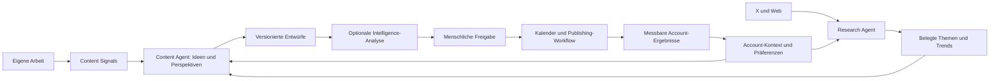

# Dispatch – Vollständiger Umsetzungsplan bis zum Endprodukt

> **Für die spätere Umsetzung:** Dies ist ein Gesamtplan mit getrennt lieferbaren Arbeitspaketen. Nach Freigabe des jeweiligen Umfangs `subagent-driven-development` für unabhängige Arbeitspakete oder `executing-plans` für sequenzielle Umsetzung verwenden. Die Checklisten dokumentieren geplante Arbeit, keinen bereits erreichten Implementierungsstand.

**Ziel:** Dispatch als verlässliches Content-System entwickeln, das eigene Arbeit und aktuelle Themen erkennt, daraus persönliche Inhalte und Kalenderpläne erstellt, nach menschlicher Freigabe veröffentlicht und aus den Ergebnissen des jeweiligen Accounts lernt.

**Architektur:** Eine React-Webanwendung auf Cloudflare, Convex als zentrales Backend für Produktdaten und Abläufe sowie Cloudflare R2 für binäre Medien. Medienmetadaten, Berechtigungen und Inhaltsreferenzen bleiben in Convex. Ein Content Agent und ein eigenständiger Recherche-Agent arbeiten über begrenzte Werkzeuge und gemeinsame Domain-APIs; dauerhafte Workflows übernehmen Integrationen, Zeitsteuerung und externe Schreiboperationen.

**Geplanter Stack:** Vite, React, TypeScript, TanStack Router, Tailwind CSS, shadcn/ui, Convex Cloud, Cloudflare R2, Better Auth, Convex Agent und Workflows, Vercel AI SDK, Requesty, GitHub App, X API, Resend, Rybbit, Stripe; weitere Plattformen und Quellen folgen über Adapter.

**Stand:** 16. September 2026  
**Status:** Planungsentwurf zur gemeinsamen Freigabe; keine Implementierung beauftragt oder begonnen  
**Bestätigte Speicherentscheidung:** Convex für Produktdaten und Abläufe, Cloudflare R2 für Medien; siehe [ADR-001](decisions/001-convex-domain-r2-media.md)

**Planungshorizont:** Technische Grundlage → Dispatch-MVP → private Beta → kommerzielle Version → lernendes, teamfähiges und kanalübergreifendes Endprodukt  
**Sprache:** Deutsche Produktplanung; technische Bezeichner auf Englisch

---

## 1. Grundlage, Verbindlichkeit und Ausgangslage

### 1.1 Gelesene Projektunterlagen

1. [Product Requirements Document](<Dispatch – Product Requirements Document.md>): Produktabsicht, V1-Anforderungen, Architektur, Erfolgsmetriken und Erweiterungen.
2. [V1 Implementation Plan](dispatch-v1-implementation-plan.md): bisherige Reihenfolge und technische Arbeitspakete.
3. [Domain-Schema](schema.ts): Entwurf der ursprünglichen V1-Entitäten.
4. [X Algorithm Intelligence](Dispatch_X_Algorithm_Intelligence.md): erklärbare Entwurfsbewertung, Performance-Feedback und Account Intelligence.
5. Präzisierung des Produktinhabers: Ein eigenständiger Recherche-Agent erkennt über X-API und Websuche proaktiv Trends und plant daraus zusätzliche Posts für den persönlichen Account. Diese Quelle ist gleichrangiger Teil des Produktkerns neben den Signalen aus eigener Arbeit.
6. Bestätigte Architekturentscheidung des Produktinhabers: Convex für Produktdaten und Abläufe, Cloudflare R2 für Medien. [ADR-001](decisions/001-convex-domain-r2-media.md) ersetzt die ursprünglichen Convex-Storage-Vorgaben für Medien in PRD §11.12, V1-Plan Ticket 3.1 und dem Schema-Entwurf. Die Originaldateien bleiben historische Grundlagen; insbesondere darf deren `mediaAssets.storageId` nicht unverändert in die Implementierung übernommen werden.

Dieser Plan führt die Unterlagen zusammen. Er ersetzt nach Freigabe den bisherigen V1-Plan als übergreifende Reihenfolge; die Originaldateien bleiben als Spezifikationsquellen erhalten. Widersprüche werden hier ausdrücklich aufgelöst. Neue Entscheidungen sind Planungsvorschläge und keine stillschweigend bestätigten Produktwünsche.

### 1.2 Tatsächlicher Ausgangspunkt

Bei Erstellung dieses Plans enthält das Projektverzeichnis die vier Unterlagen in `.docs`, aber noch keine Anwendungsstruktur, kein `package.json` und kein initialisiertes Git-Repository. `schema.ts` ist ein Dokumentationsentwurf, kein bereits betriebenes Backend. Sämtliche nachfolgend genannten Anwendungsdateien sind geplante Dateien.

Es werden keine bestehenden Komponenten, Tests, Deployments oder Provider-Zugänge als funktionsfähig vorausgesetzt. Aktuelle Paketversionen werden bei Beginn eines Arbeitspakets verifiziert und anschließend im Lockfile fixiert.

### 1.3 Aufgelöste Umfangsfragen

| Thema | Entscheidung dieses Plans | Konsequenz |
|---|---|---|
| Proaktive Recherche | Eigene Kernverantwortung mit eigenem Agenten, Profilen und Läufen | Ein reiner GitHub-Generator ist noch kein vollständiges Dispatch-MVP |
| Anzahl der Agenten | Content Agent und Research Agent; gemeinsamer Convex-Unterbau | Die ursprüngliche Beschränkung auf einen einzigen Agenten wird gezielt erweitert |
| Wochenplanung | Bestandteil des Dispatch-MVP | Die bisherige Bezeichnung als V1.x wird für diese Funktion aufgehoben |
| Algorithm-MVP | Separate Beta-Ausbaustufe nach funktionierendem Kernloop | Der Scheduler und die Intelligence-Schicht erhalten keine konkurrierenden MVP-Definitionen |
| Performance Learning | Nach Erfassung belastbarer eigener Daten | Vorherige Scores bleiben ausdrücklich heuristisch |
| Freigabe | An Account und konkrete Entwurfsversion gebunden | Ein globaler Draft-Status genügt nicht als Veröffentlichungserlaubnis |
| Vollautonomie | Freiwillige, eingeschränkte Endprodukt-Funktion mit eigener Freigabe | Standard bleibt menschliche Inhaltsfreigabe |
| Teams und Plattformen | Strukturell vorbereitet, nach bewährtem Einzelanwenderprodukt ausgebaut | Kein umfangreicher Team- oder Plattformapparat vor dem Kernnutzen |
| Billing | Nach nutzbarem Kernloop, vor kommerzieller Veröffentlichung | Private Alpha benötigt keine echte Zahlungsabwicklung |
| Medienspeicher | Vom Produktinhaber bestätigt: Cloudflare R2 für Bilder, GIFs und Videos; Metadaten in Convex | Kein zweites Business-Backend; gezielte Anpassung von Upload, Asset-Modell, Publishing und Löschung |

### 1.4 Arbeitsweise und Backlog

- Dieser Plan ist ein Dokumentationsartefakt. Er legt noch keine Implementierungstickets als erledigt an.
- Vor jedem nicht trivialen Coding-Arbeitspaket wird per Backlog-CLI eine Aufgabe mit Titel, Beschreibung, Kriterien und Plan angelegt. Die Kennungen `Pxx.yy` dieses Dokuments dienen als Referenz, nicht als erfundene Backlog-IDs.
- Backlog-Dateien werden nie direkt bearbeitet. Fortschritt und verifizierte Kriterien werden über die CLI gepflegt.
- Ein Backlog-Ticket bleibt bis zur ausdrücklichen Bestätigung nach manueller Prüfung offen. Der Agent darf es nicht selbstständig auf `Done` setzen.
- Entscheidungen und abweichende Umfänge werden im jeweiligen Ticket und im Entscheidungsprotokoll dokumentiert.
- Implementierungspakete werden bei Bedarf vor Beginn in kleinere Tests, Domain-Operationen und UI-Schritte zerlegt. Dieser Gesamtplan enthält bewusst keinen vorab erfundenen Anwendungscode.

## 2. Produktziel und Definition des Endprodukts

### 2.1 Das zu lösende Problem

Die eigentliche Arbeit eines Builders und seine öffentliche Kommunikation sind getrennt. Dispatch soll die wiederkehrende Denkarbeit übernehmen: interessante Anlässe entdecken, deren Relevanz beurteilen, eine eigene Perspektive finden, formulieren und verlässlich einplanen. Persönliche Erfahrung und fachliche Substanz bleiben die Grundlage.

Der Erfolg bemisst sich an brauchbaren, tatsächlich freigegebenen Inhalten und geringerer redaktioneller Arbeit. Die Anzahl generierter Entwürfe allein ist kein Erfolgskriterium.

### 2.2 Zwei gleichberechtigte Eingänge

**Eigene Arbeit:** GitHub-Pushes und Releases, später Pull Requests, Projektmanagement, Notizen, Gespräche und Feedback.

**Aktuelle Themen:** X-Diskussionen und Webquellen, proaktiv recherchiert, zeitlich eingeordnet, auf Zielgruppe und Projekte bezogen und mit überprüfbaren Quellen versehen.

Beide Eingänge dürfen eigenständig zu Ideen führen. Ein Trend benötigt keinen GitHub-Bezug, muss aber zum Account passen. Eine Projektänderung benötigt keinen Trend, wenn sie bereits eine gute Geschichte trägt. Ein dritter Fall kombiniert beide Quellen.

Die Intelligence-Analyse darf ausfallen, ohne einen ansonsten gültigen, manuell freigegebenen Post zu blockieren. Inhaltsfreigabe und Kalenderannahme werden klar auseinandergehalten.

### 2.3 Fähigkeiten des reifen Kernprodukts

1. Ein Builder erhält aus eigener Arbeit und externer Recherche einen nachvollziehbaren Vorrat an Ideen.
2. Der Agent kennt Projekte, Zielgruppen, Themen, Sprache, Ton, Tabuthemen und Veröffentlichungspräferenzen.
3. Der Nutzer kann Ideen, Entwürfe, Optimierungsvorschläge und Wochenpläne selektiv annehmen oder ablehnen.
4. Beiträge, Threads und unterstützte Medien werden zuverlässig auf verbundenen Accounts veröffentlicht.
5. Das Produkt erklärt Herkunft, Unsicherheit, Bearbeitungsstand und Veröffentlichungsergebnis.
6. Gemessene Performance und redaktionelles Feedback verbessern zukünftige Empfehlungen, soweit die Daten dies tragen.
7. Teams können Rechte, Kommentare und Freigaben nutzen, ohne Mandantengrenzen zu verletzen.
8. Mehrere Plattformen erhalten eigene Inhaltsvarianten und Fähigkeiten statt unveränderter Textkopien.
9. Das Produkt ist bezahlbar betreibbar, zugänglich, exportierbar, löschbar und im Fehlerfall wiederherstellbar.

### 2.4 Umfang und bewusste Grenzen

Das Endprodukt umfasst die Kernfähigkeiten sowie ein priorisiertes Erweiterungsportfolio aus Abschnitt 13. Nicht automatisch Bestandteil sind eine Social Inbox, autonomes Reply Management, umfassendes Community Management, ein CRM oder ein eigener LLM-, E-Mail- oder Payment-Service. Dafür nennen die Unterlagen keinen ausreichend konkreten Produktauftrag.

Bildgenerierung, Video, weitere Quellen und zusätzliche soziale Plattformen bekommen konkrete Ausbauschritte, aber jeweils ein wirtschaftliches und technisches Eingangstor. „Endprodukt“ bedeutet ein belastbares, ausbaufähiges Produkt und keinen zeitlich unbegrenzten Funktionskatalog.

## 3. Verbindliche Nutzerabläufe

| ID | Ablauf | Erwartetes Ergebnis |
|---|---|---|
| J01 | Registrieren → E-Mail bestätigen → Workspace → X verbinden → Präferenzen | Verständlicher Einstieg mit anschließendem ersten Entwurf |
| J02 | Manueller Entwurf → Medien → konkrete Version freigeben → Termin → Veröffentlichung | Vollständiger verlässlicher Publishing-Loop |
| J03 | GitHub verbinden → Repository aktivieren → Push/Release → bewertetes Signal → Idee → Entwurf | Eigene Arbeit wird zu nachvollziehbarem Content |
| J04 | Recherche-Profil aktivieren → geplanter X-/Web-Lauf → neues passendes Thema → Idee → Entwurf | Zusätzlicher Content auch ohne neues Arbeitssignal |
| J05 | Thema im Chat nennen → gezielte Recherche → belegte Zusammenfassung → eigener Blickwinkel | Manuelle und proaktive Recherche nutzen denselben Qualitätsvertrag |
| J06 | Drei Posts für nächste Woche anfragen → Quellenmix → Entwürfe und Slots prüfen → Teilmenge annehmen | Kalender wird nur um explizit angenommene Vorschläge ergänzt |
| J07 | Entwurf analysieren → bis zu drei Verbesserungen → Diff prüfen → Änderung übernehmen | Neue Version; alte Freigabe wird nicht stillschweigend übertragen |
| J08 | Teilweise veröffentlichter Thread oder unklarer API-Ausgang → sichtbarer Zustand → Abgleich → gezielte Fortsetzung | Kein blindes Wiederholen bereits gesendeter Beiträge |
| J09 | Ergebnisse und Bearbeitungsfeedback betrachten → Präferenzen oder Lernvorschlag bestätigen | Nachvollziehbar bessere nächste Vorschläge |
| J10 | Teammitglied einladen → Rolle vergeben → kommentieren → freigeben | Klare Verantwortlichkeiten und nachvollziehbare Entscheidungen |
| J11 | Eine Idee → X-Thread und LinkedIn-Variante → getrennte Freigaben und Zeitpunkte | Kanalgeeignete Varianten ohne ungewollte gekoppelte Änderungen |
| J12 | Integration trennen oder Workspace löschen | Laufende Jobs werden gestoppt und betroffene Daten kontrolliert entfernt |

## 4. Architektur und Verantwortungsgrenzen

### 4.1 Grundentscheidungen

- **Convex ist die einzige Quelle des Business-Zustands.** Cloudflare hostet die Oberfläche und über R2 die binären Medien. Berechtigungen, Asset-Status, Agenten und Workflows bleiben in Convex; eine zusätzliche Worker-Brücke wird nur bei einem konkret nachgewiesenen Bedarf eingeführt.
- **Medienbytes und Medienmetadaten sind getrennt.** Autorisierte Browser-Uploads und Vorschauabrufe laufen möglichst direkt über Cloudflare R2. Convex speichert stabile Objektverweise und erteilt begrenzte Zugriffe; signierte URLs sind kurzlebige Transportmittel und keine dauerhaften Inhaltsreferenzen.
- **Workspaces sind Mandanten.** Authentifizierung wird serverseitig in einen Domain-User übersetzt; Rollen und jede referenzierte Entität werden im Workspace geprüft.
- **Agenten entscheiden innerhalb begrenzter Aufgaben.** Sie erhalten keine frei wählbare `workspaceId` als Autorität und keine allgemeinen Datenbank-Schreibwerkzeuge.
- **Workflows führen aus.** Zeitplanung, Wiederaufnahme, Deduplizierung, Fehlerbehandlung und externe Schreiboperationen werden deterministisch gesteuert.
- **Provider werden gekapselt.** Modelle, Suche, Publishing, Billing und Benachrichtigungen erhalten testbare Adapter.
- **Inhalte bleiben versioniert.** Text, Medienreferenzen und veröffentlichungsrelevante Metadaten bilden gemeinsam den Inhalt einer Version.
- **Fähigkeiten werden geprüft.** Ein verbundenes Konto ist nicht automatisch für Recherche, jedes Medienformat oder jede Kennzahl berechtigt.

### 4.2 Content Agent

Aufgaben: Arbeitssignale und Recherche lesen, relevante Perspektiven vorschlagen, Ideen und Entwürfe erzeugen, Texte auf ausdrücklichen Auftrag überarbeiten, Kalenderpläne vorschlagen und Begründungen liefern.

Werkzeugfamilien: Kontext lesen, Research-Auftrag anlegen, Idee erzeugen, Entwurfsversion erzeugen, Planvorschlag anlegen. Planannahme und Inhaltsfreigabe bleiben autorisierte Domain-Aktionen. Ein Agent kann keine menschliche Freigabe erzeugen, kein fremdes Workspace auswählen und in der Standardkonfiguration nicht unmittelbar veröffentlichen.

### 4.3 Research Agent

Aufgaben: Aus einem begrenzten Research-Auftrag Suchfragen ableiten, X und Web abfragen, Quellen prüfen, Ereignisse clustern, Aktualität und Relevanz bewerten und Content-Möglichkeiten zurückgeben.

Ein Auftrag enthält Account, Profilversion, Anlass, Zeitfenster, Suchsprachen, Quellenarten, Themen, Ausschlüsse, maximalen Umfang, Frist und Budget. Ergebnis ist ein strukturiertes Research-Paket mit Thema, Zusammenfassung, Evidenz, Zeitbezug, eigener Interpretation, Relevanz, Neuigkeit, Unsicherheit, Verfallszeit und möglichen Perspektiven.

Der Agent verändert keine freigegebenen Entwürfe und keine Kalendertermine. Er kann geprüfte Ergebnisse zur Ideen- und Planerstellung an den Content Agent übergeben. Er bleibt ohne eingeschaltetes Research-Profil oder ausdrücklich gestarteten Auftrag inaktiv.

### 4.4 Gemeinsame Laufsteuerung

Agent-Läufe bekommen IDs, Prompt-/Modellversion, Tenant-Kontext, Budget, maximale Tool-Schritte, Timeout und Abbruchsignal. Die Weitergabe zwischen Agenten ist ein gespeicherter Arbeitsauftrag, keine unbegrenzte gegenseitige Unterhaltung.

Vor jedem kostenpflichtigen Schritt werden Mittel reserviert; danach werden Verbrauch und Reservation abgeglichen. Wiederholungen desselben Schritts dürfen nicht erneut unbemerkt das Budget verbrauchen. Globale Provider-Limits, Workspace-Kontingente und Account-Limits sind getrennte Grenzen.

Ein Abbruch sperrt weitere Schritte und Domain-Schreibzugriffe über einen dauerhaft gespeicherten Run-/Workspace-Status. Bereits laufende Actions können trotzdem fertig werden; deren Ergebnisse und Kosten werden abgeglichen. Vor jedem weiteren Tool- oder Provider-Aufruf wird der Status erneut geprüft. Bereits abgesendete externe Schreibaufrufe lassen sich dadurch nicht zurückholen.

Ein Provider-Versuch besitzt eine eigene Kennung: Seine Verbrauchsbuchung wird dedupliziert, ein tatsächlich erneut ausgeführter Modell- oder Suchaufruf kann jedoch erneut Geld kosten und benötigt Budget. SDK-Retries, Workflow-Retries und eigene Wiederholungen erhalten eine gemeinsame Obergrenze. Ein kompletter Agent-Lauf wird nicht pauschal wiederholt; Prompt-/Nachrichtenreferenzen und Domain-Operationen bleiben bei Wiederaufnahme stabil.

### 4.5 Geplante Modulstruktur

| Pfad | Verantwortung |
|---|---|
| `src/routes/` | Öffentliche Seiten, Auth, Workspace-Routen und Navigation |
| `src/features/onboarding/` | Geführter Einstieg, Account-Kontext und erste Aktivierung |
| `src/features/drafts/` | Composer, Thread-Reihenfolge, Versionen und Medien |
| `src/features/calendar/` | Woche, Monat, Agenda, Zeitzonen und Vorschlagsannahme |
| `src/features/signals/`, `src/features/ideas/` | Arbeitsereignisse, Perspektiven und Quellenbezug |
| `src/features/research/` | Profile, Inbox, Quellen, Trends, Läufe und Budgetstatus |
| `src/features/agent/` | Persistenter Chat, Arbeitsfortschritt und Vorschlagskarten |
| `src/features/intelligence/`, `src/features/analytics/` | Entwurfsanalyse, Performance und Lernvorschläge |
| `src/features/settings/`, `src/features/team/` | Accounts, Einstellungen, Billing und Zusammenarbeit |
| `src/components/ui/`, `src/lib/` | Gemeinsame UI, Datumsdarstellung, Fehler- und Analytics-Grenzen |
| `convex/schema.ts`, `convex/lib/authz.ts` | Domain-Schema, Identität, Rollen und Referenzprüfung |
| `convex/content/` | Ideen, Entwürfe, unveränderliche Versionen und Freigaben |
| `convex/publishing/` | Planung, Zustandsautomaten, Versuche, Einzelbeiträge und Abgleich |
| `convex/integrations/github/`, `convex/integrations/x/` | Provider-Clients, OAuth, Webhooks und Fähigkeiten |
| `convex/research/` | Profile, Aufträge, Evidenz, Cluster, Frische und Zeitsteuerung |
| `convex/ai/` | Content Agent, Research Agent, Tools, Modelle, Prompts und Evaluation |
| `convex/planning/` | Kalenderkontext, Vorschläge, Konflikte und Annahme |
| `convex/intelligence/`, `convex/performance/` | Profile, Predictions, Snapshots und Kalibrierung |
| `convex/billing/`, `convex/operations/` | Entitlements, Usage, Ereignisse, Export und Löschung |
| `convex/team/`, `convex/media/`, `convex/email/` | Zusammenarbeit, R2-Anbindung/Asset-Metadaten und Benachrichtigungen |
| `tests/e2e/`, `tests/fixtures/`, `tests/evals/` | Nutzerflüsse, bereinigte Provider-Beispiele und AI-Referenzfälle |
| `.docs/decisions/`, `.docs/runbooks/` | Entscheidungen, Betriebsanleitungen und Nachweise |

Bestehende Dateien werden nicht allein zur Einhaltung dieses Rasters umbenannt, falls bei Umsetzungsbeginn inzwischen Code existiert. Funktionsgrenzen haben Vorrang vor einem starren Verzeichnisbaum.

## 5. Datenmodell und verbindliche Zustandsregeln

### 5.1 Bestehende Entitäten weiterverwenden

`users`, `workspaces`, `memberships`, `integrations`, `integrationSecrets`, `repositories`, `socialAccounts`, `contentSignals`, `researchItems`, `contentIdeas`, `drafts`, `draftVersions`, `mediaAssets`, `scheduledPosts`, `publishedPosts`, `agentRuns` und `systemEvents` bleiben die Ausgangsbasis.

Sie werden fachlich validiert und ergänzt. Insbesondere reicht ein Index allein nicht als Deduplizierungsgarantie: Prüfung und Änderung müssen atomar und unter konkurrierenden Aufrufen getestet werden.

### 5.2 Ergänzungen nach Einführung

| Bereich | Neue oder erweiterte Entitäten | Verbindliche Inhalte und Einführung |
|---|---|---|
| Persönlicher Kontext | `workspacePreferences`, `accountProfiles`, `projectContexts` | Sprache, Zeitzone, Zielgruppe, Ziele, Ton, Themen, Ausschlüsse; P01 |
| Integration | `oauthSessions`, `webhookDeliveries`, `accountCapabilities` | State/PKCE-Lebensdauer, Zustellung und Verarbeitung getrennt, erlaubte Provider-Funktionen; P01–P04 |
| Inhaltsfreigabe | `draftApprovals` | Workspace, Draft, Version, Account, Person, Zeitpunkt, Widerruf; P02 |
| Medien | Erweiterte `mediaAssets`, `mediaUploadSessions` | R2-Bucket-/Objektverweis statt `_storage`-ID, validierter Inhalt, Upload-/Löschstatus und Workspace-Zuordnung; P02 |
| Publishing | `publishAttempts`, `publishedPostItems` | Versuch-ID, Operation-ID, Einzelelement, externe ID, Ergebnis und Abgleich; P03 |
| Agent-Kontext | `agentConversations`, erweiterte `agentRuns` | Zuordnung von Component-Thread zu Workspace, Agent, Budget und Version; P05 |
| Redaktionelles Feedback | `contentFeedback` | Annahme, Ablehnung, begründete Korrektur, Versionsbezug; P05 |
| Recherche | `researchProfiles`, `researchRuns`, `researchEvidence`, `topicClusters`, `researchSchedules` | Versionierter Auftrag, Provenienz, Zeitbezug, Neuigkeit, Fortschritt; P06 |
| Planung | `contentPlans`, `contentPlanItems` | Gewünschter Zeitraum, Quellmix, konkrete Version, vorgeschlagener Slot, Annahme; P07 |
| Intelligence | `algorithmProfiles`, `audienceProfileVersions`, `postPredictions` | Geprüfte Profilversion, Analysemodell und konkrete Draft-Version; P08 |
| Betrieb | `notificationPreferences`, `notificationDeliveries`, `auditEvents`, `dataLifecycleJobs` | Versandstatus, sicherheitsrelevante Vorgänge, Export und Löschung; P09 |
| SaaS | `subscriptions`, `entitlementGrants`, `usageLedger`, `usageReservations` | Provider-unabhängige Rechte, unveränderlicher Verbrauch und Reservierungen; Budgetanteil ab P05, Monetarisierung P10 |
| Performance | `postPerformanceSnapshots`, `accountBaselines`, `accountPerformanceModels` | Einzelpost-Bezug, Alter, verfügbare Metriken, Daten- und Modellversion; P11 |
| Personalisierung | `contentPillars`, `styleProfileVersions`, `learningProposals`, `experiments` | Belegbares, korrigierbares Lernen und begrenzte Tests; P12 |
| Zusammenarbeit | `invitations`, `comments`, `approvalPolicies` | Ablaufende Einladungen, versionsbezogene Kommentare, Rollenregeln; P13 |
| Mehrere Plattformen | `contentPackages`, `contentVariants` | Eine Idee, getrennte Plattform-Drafts, Accounts und Status; P14 |
| Quellen und Medien | `sourceSubscriptions`, `mediaGenerationJobs` | Quellzugang, Herkunft, Nutzungsgrenzen und nachvollziehbare Generierung; P15 |
| Optionale Autonomie | `automationPolicies`, `automationDecisions` | Explizite Zustimmung, Geltungsbereich, Regelversion und Entscheidung; P16 |

Jede Workspace-Entität bekommt Tenant-Indizes, serverseitige Zugriffskontrollen und definierte Lösch-/Exportregeln. Globale Algorithmusprofile bleiben von privaten Account-Daten getrennt. Embeddings und abgeleitete Modelle sind ebenfalls nutzerbezogene Daten und keine Ausnahme von der Löschung.

### 5.3 Inhalts- und Freigabeinvarianten

1. Eine Entwurfsversion wird nach Erstellung nicht verändert. Medieninhalt, Reihenfolge und relevante Metadaten sind versioniert oder als Snapshot fixiert.
2. Eine Freigabe gilt exakt für `(workspaceId, draftVersionId, socialAccountId)`.
3. Ein neuer Text, ein anderes Medium, eine geänderte Thread-Reihenfolge oder ein anderer Zielaccount benötigt eine neue Freigabe.
4. Der Kalender referenziert eine konkrete freigegebene Version. Spätere Bearbeitung verändert diesen Inhalt nicht.
5. Ein Nutzer sieht klar: „Neue Arbeitsversion vorhanden; geplant bleibt Version X.“ Der Austausch erfordert eine ausdrückliche Aktion.
6. Das Verschieben innerhalb erlaubter Zeiträume ändert den Inhalt nicht. Abgelaufene zeitkritische Recherche verlangt vor Veröffentlichung eine erneute Prüfung.
7. Der Publishing-Start validiert Freigabe, Policy, Account, Medien und Lifecycle-Zustand erneut.

### 5.4 Scheduling und externe Schreiboperationen

Geplante Zustände: `scheduled`, `publishing`, `partially_published`, `published`, `failed`, `reconciliation_required`, `cancelled`. Übergänge sind explizite Domain-Operationen; Statuswerte werden nicht frei aus der UI gesetzt.

- Ein Job darf eine Planung atomar für genau eine gültige Ausführungsgeneration beanspruchen.
- Rescheduling erhöht die Generation; ein alter Scheduler-Aufruf wird damit wirkungslos.
- Jeder Thread-Beitrag besitzt eine feste Position, Operation-ID und einen gespeicherten Veröffentlichungsfortschritt.
- Vor jedem externen Schreibaufruf wird dessen Versuch dauerhaft erfasst. Nach einem Prozessabbruch mit offenem Versuch wird zunächst der Ausgang geklärt; fehlende lokale Bestätigung ist kein Beweis, dass nichts veröffentlicht wurde.
- Nach bestätigtem Provider-Erfolg wird die externe ID gespeichert, bevor der nächste Beitrag startet.
- Bei einem Timeout nach möglicherweise erfolgreichem Schreiben wird nicht blind wiederholt. Der Versuch wechselt in `reconciliation_required`.
- Lässt sich der Provider-Zustand nicht eindeutig auflösen, wird die Veröffentlichung pausiert und der Nutzer erhält konkrete Wiederherstellungsoptionen.
- Ein teilweise veröffentlichter Thread zeigt veröffentlichte und ausstehende Elemente. Fortsetzung und Abbruch werden getrennt angeboten.
- Abbruch kann bereits veröffentlichte Inhalte nicht rückgängig machen. Externes Löschen ist eine eigene, ausdrücklich bestätigte Aktion.
- Kein Architekturversprechen einer absoluten „Exactly once“-Garantie über eine fremde API ohne entsprechende Provider-Unterstützung. Ziel ist: Duplikate vermeiden und unklare Ergebnisse sicher behandeln.

### 5.5 Recherche- und Planungszustände

Research Run: `queued → running → completed | partial | failed | budget_exhausted | cancelled`. Ein leeres, korrektes Ergebnis ist `completed` mit null passenden Themen, kein technischer Fehler.

Research Item: Verarbeitung und redaktionelle Behandlung werden getrennt modelliert. Beispielsweise `processingStatus` und `reviewStatus`; „archiviert“ ist kein gescheiterter Suchlauf.

Plan: `proposed → partially_accepted | accepted | rejected | expired`. Jedes Planelement speichert seinen eigenen Status. Annahme prüft erneut Account, Freigabe, Slot und Aktualität. Zwei parallele Annahmen erzeugen keine doppelten Termine.

### 5.6 Datenminimierung und Provenienz

Große GitHub-Diffs, vollständige fremde Webseiten und rohe Provider-Antworten gehören nicht dauerhaft in gewöhnliche Domain-Dokumente. Gespeichert werden zweckgebundene Zusammenfassungen, Quellenkennungen, Zeitstempel und begrenzte Evidenz. Benötigte Diagnoseartefakte erhalten begrenzten Zugriff und kurze Aufbewahrung.

Private Repository-Inhalte, Prompts und Post-Texte dürfen nicht an Produktanalytics oder Session-Replay gelangen. Externe Inhalte sind untrusted input: Sie dürfen keine Agent-Berechtigung, Systemanweisung oder Workspace-Grenze verändern.

### 5.7 Medienvertrag für Convex und Cloudflare R2

`mediaAssets` bleibt eine Convex-Domain-Entität. Anstelle von `storageId: Id<"_storage">` sind `storageProvider = "r2"`, ein serverseitig aufgelöster Bucket-Verweis und ein unverwechselbarer finaler Objektschlüssel vorgesehen. Dazu kommen Workspace, validierter MIME-Typ, Größe, Dimensionen, geprüfte Inhaltsprüfsumme und Lifecycle-Status. Der finale Objektverweis kann vor Upload-Abschluss fehlen; nur ein Asset im Status `ready` darf freigegeben oder veröffentlicht werden.

Geplanter Lifecycle: `uploading → validating → ready | failed`; Löschung erfolgt über `deleting → deleted`. `mediaUploadSessions` binden die temporäre Uploadfläche, zulässige Grenzen, Ablaufzeit und den idempotenten Abschluss an den berechtigten Workspace.

Direkte Uploads schreiben ausschließlich in einen temporären Bereich. Die Finalisierung erstellt ein neues finales Objekt, für das keine Browser-Schreibberechtigung existiert, und prüft die tatsächlich dort gespeicherten Bytes. Erst nach dieser Prüfung darf das Asset `ready` werden. Parallele Abschlussversuche dürfen nicht mehrere sichtbare Assets erzeugen. Ein noch gültiger Upload-Link darf keinen bereits freigegebenen Inhalt überschreiben. Reguläre Produktfunktionen überschreiben finale Objekte nicht; Änderungen erzeugen ein neues Asset und eine neue Entwurfsversion. ETag und Inhaltsprüfsumme werden nicht ungeprüft gleichgesetzt.

R2 und Convex bilden keine gemeinsame Transaktion. Upload-Abschluss, Metadatenspeicherung und Löschung benötigen wiederholbare Schritte, einen gespeicherten Fortschritt und Aufräum-/Abgleichjobs. Während `deleting` sind neue Referenzen und Publishing-Claims gesperrt. Normale Asset-Löschung respektiert bestehende Referenzen; eine ausdrücklich autorisierte Workspace-Löschung beendet zunächst die betroffenen Abläufe und sperrt neue Finalisierungen. Löschmarkierungen bleiben bis zur Nachbereinigung nach Ablauf bereits erteilter Uploadberechtigungen erhalten, damit erneut hochgeladene temporäre Objekte nicht zurückbleiben.

Die R2-Komponente ersetzt diesen Domain-Vertrag nicht: `onUpload` beziehungsweise `syncMetadata` sind kein Nachweis einer Inhaltsprüfung. Öffentliche Endpunkte prüfen Workspace und Uploadsession auch bei Metadatenabgleich, Lese-URL-Ausgabe und Löschung. Private Vorschauen verwenden signierte S3-URLs; daraus folgt weder eine öffentliche Medien-Domain noch automatisches CDN-Caching.

## 6. Recherche, Trendqualität und Kalenderplanung

### 6.1 Research Profile pro Account

Ein Profil definiert Themen, Projektbezug, Zielgruppe, Sprachen, Regionen soweit unterstützt, bevorzugte Quellen, Ausschlüsse, Aktualitätsfenster, Frequenz, Themenanzahl und Kostenlimit. Vorschlag für die private Alpha: ein ausdrücklich aktivierter täglicher Lauf plus manuelle Läufe; Frequenz und Budget sind konfigurierbar, nicht als versteckte Daueraktivität voreingestellt.

Profiländerungen gelten für neue Läufe. Ein laufender Auftrag behält seine Profilversion, kann aber durch den Nutzer abgebrochen werden. Entfernte Zugänge oder ein gesperrter Workspace sperren weitere Aufrufe gemäß Abschnitt 4.4; bereits laufende externe Anfragen benötigen einen Ergebnis- und Kostenabgleich.

### 6.2 Trend statt bloßer Suchtreffer

Der Research Agent trennt Suchrelevanz, aktuelle Aufmerksamkeit und belegbare zeitliche Entwicklung. Hohe Gesamtreaktionen allein beweisen keinen Trend. Wo Vergleichsdaten fehlen, lautet die Einordnung „aktuell diskutiertes Thema“ statt „steigender Trend“.

Bewertungskomponenten: Account-Relevanz, Aktualität, Quellenqualität, Neuigkeit gegenüber eigener Historie, beobachtbare Dynamik, Redundanz und Unsicherheit. Quellenabhängige Metriken werden nicht ohne Normalisierung gegeneinander gerechnet. Grenzwerte werden an einer kuratierten Stichprobe überprüft.

Ein Ergebnis enthält mindestens eine belastbare Quelle. Bei umstrittenen oder folgenreichen Tatsachen werden unabhängige Belege gesucht; fehlt die Bestätigung, bleibt die Unsicherheit sichtbar. Syndizierte Kopien derselben Meldung zählen nicht als unabhängige Quellen.

### 6.3 Pipeline

1. Auftrag erzeugen und Budget reservieren.
2. Begrenzte Suchfragen aus Profil, Projektkontext und bereits behandelten Themen bilden.
3. X und Web über getrennte Adapter mit eigenen Limits abfragen.
4. Quellen normalisieren, kanonische URLs beziehungsweise Post-IDs speichern und Duplikate entfernen.
5. Veröffentlichungszeit, Beobachtungszeit und eventuelles Ereignisdatum unterscheiden.
6. Ähnliche Ergebnisse zu Themen clustern und vorhandene Cluster aktualisieren.
7. Relevanz, Neuigkeit, Beleglage und Verfallszeit bestimmen.
8. Passende Perspektiven formulieren; fremde Behauptungen und eigene Interpretation getrennt ausweisen.
9. Ergebnisse in die Research Inbox geben und bei aktivierter Option die Erstellung von Ideen/Entwürfen anstoßen.
10. Verbrauch, Teilerfolg und nächsten Lauf speichern; keine automatische Veröffentlichung.

### 6.4 Gemeinsame Planung

Der Planer berücksichtigt vorhandene Termine, Posting-Frequenz, lokale Zeitzone, Zielaccounts, Themenvielfalt, Quellenmix, Medienbereitschaft, Redundanz, Freigabestatus und zeitliche Gültigkeit der Recherche.

Er darf weder bestehende Termine überschreiben noch künstlich irrelevante Beiträge erzeugen, nur um eine angefragte Anzahl zu erreichen. Reicht das Material für zwei gute statt fünf Posts, zeigt der Plan diese Lücke und bietet zusätzliche Recherche an.

Die erste Version nutzt vom Nutzer definierte Zeitfenster. Personalisierte Timing-Empfehlungen folgen erst mit geeigneten Account-Daten. Frische-sensitive Themen werden unmittelbar vor dem geplanten Versand erneut geprüft oder zur redaktionellen Prüfung zurückgestellt.

## 7. Algorithm Intelligence und Lernen

### 7.1 Einordnung des Scores

Der Reach Score ist zunächst eine erklärbare redaktionelle Heuristik von 0–100. Er ist weder eine Reichweitenprognose in Impressionen noch eine Wahrscheinlichkeit oder ein nachgebautes X-Ranking. UI und Marketing dürfen diesen Unterschied nicht verwischen.

Startmodell aus der Spezifikation: Audience Fit 25 %, Share Potential 20 %, Conversation Potential 15 %, Follow Potential 10 %, Dwell Potential 10 %, Discovery Potential 10 %, Content Health 10 %. Alle sieben Komponenten erhalten konsistente technische Namen. Die im bisherigen JSON-Beispiel fehlende Discovery-Komponente wird ergänzt.

Follower- und Discovery-Eignung bleiben getrennte Heuristiken. Die Anzeige „+8“ bezeichnet ausschließlich die Veränderung des Dispatch-Scores zwischen zwei Versionen unter denselben Analysebedingungen, nicht acht Prozent mehr Reichweite.

### 7.2 Reproduzierbare Analyse

Eine Prediction referenziert `draftVersionId`, Zielaccount, Audience-Profilversion, Algorithmusprofilversion, Account-Baseline falls vorhanden, Promptversion, Modellkennung, Analysekonfiguration und Zeitpunkt. Die bisherige Referenz auf eine nicht existierende `posts`-Tabelle entfällt.

Gleiche Inputs können bei einem LLM dennoch unterschiedliche Ausgaben erzeugen. Nachvollziehbarkeit bedeutet gespeicherte Inputs, Konfiguration und Ergebnis, keine Behauptung bitgenauer Wiederholbarkeit.

Ohne Audience-Profil wird kein erfundener Audience-Fit angezeigt: Die UI bietet die Profilanlage an und kennzeichnet den Gesamtscore als unvollständig oder zeigt zunächst nur die bewertbaren Dimensionen. Ohne Post-Historie funktioniert die allgemeine Analyse mit sichtbar begrenzter Confidence.

### 7.3 Feedback und Performance

- Redaktionelles Feedback wird ab dem ersten AI-Entwurf erfasst: akzeptiert, leicht oder stark verändert, abgelehnt und optional warum.
- Performance-Snapshots starten erst nach Veröffentlichung und nur für tatsächlich verfügbare, berechtigte Metriken.
- Vorgesehene Altersfenster sind 15 Minuten, 1, 6, 24 und 48 Stunden; Budget und API-Fähigkeiten bestimmen, welche davon aktiv sind.
- Fehlende Werte sind `unavailable`, `not_authorized`, `not_yet_available` oder `failed`, niemals stillschweigend null.
- Threads erhalten Einzelpost-Metriken und ausdrücklich bezeichnete Aggregate; addierte Impressionen sind keine deduplizierte Personenreichweite.
- Historisch importierte Posts werden als solche markiert und besitzen keine erfundene Pre-Publish-Prediction.

### 7.4 Lernstrategie

Zuerst beschreibende Account-Baselines, danach bewertete Vorschläge, zuletzt optionale adaptive Modelle. Verglichen werden gleiche Messalter und passende Formate. Reichweitenänderungen durch Account-Wachstum, Saisonalität oder kleine Stichproben werden kenntlich gemacht.

Als anfängliches Produkt-Gate gelten 30 auswertbare Posts über mindestens vier Wochen für erste vorsichtige Account-Empfehlungen. Das ist eine vorgeschlagene Mindestschwelle, kein statistischer Nachweis; jede Aussage benötigt zusätzlich ausreichende Daten in ihrem konkreten Segment. Unterhalb der Schwelle werden keine personalisierten „besten Zeiten“ behauptet.

Modelländerungen laufen zunächst im Schattenbetrieb gegen die bisherige Heuristik. Zeitlich getrennte Evaluation verhindert Zukunftswissen im Training. Nur nachweislich bessere, ausreichend stabile Modelle werden aktiviert und bleiben rückrollbar. Experimente dürfen keinen zusätzlichen Spam oder ungeprüfte Veröffentlichungen erzeugen.

## 8. Release-Stufen und Abhängigkeiten

| Release | Enthaltene Phasen | Nutzerwert und Abschluss |
|---|---|---|
| R0 – tragfähige Grundlage | P00–P01 | Machbarkeit, Anmeldung, Mandanten und Account-Kontext |
| R1 – interner Publishing-Alpha | P02–P03 | Manueller X-Loop mit Freigabe, Kalender und Fehlerbehandlung |
| R2 – Dispatch-MVP | P04–P07, verpflichtende Basismaßnahmen aus P09 | Eigene Arbeit und proaktive Recherche erzeugen gemeinsam planbare Inhalte |
| R3 – private Beta | P08–P09 | Erklärbare Intelligence, Datenschutz, Zugänglichkeit und belastbarer Betrieb |
| R4 – kommerzielles X-Produkt | P10 und GA-Gate | Abrechnung, Grenzen, Support und produktive Freigabe |
| R5 – lernendes Produkt | P11–P12 | Performance-Feedback, persönliche Stimme und bessere Planung |
| R6 – Teamprodukt | P13.01–P13.02 | Zusammenarbeit, Rollen und Freigaberegeln; Kundenräume optional |
| R7 – kanalübergreifendes Produkt | P14.01–P14.03; P14.04 optional | Gemeinsame Ideen mit eigenständigen Plattformvarianten |
| R8 – ausgebautes Endprodukt | Ausgewählte P15-Pakete und Endprodukt-Gate | Priorisierte zusätzliche Arbeitsquellen, Wiederverwertung und Medien |
| R9 – optionale kontrollierte Autonomie | P16 | Eng begrenzte, ausdrücklich aktivierte Automatisierung |

Datenschutz, Authentifizierung, Kostenkontrolle, Logging und Tests werden in jeder Phase umgesetzt; P09 konsolidiert sie für den Betrieb. P10 darf nach stabilem R3 parallel zur Datensammlung für P11 laufen. Team- und Plattformausbau können nach gemeinsamen Schema-Verträgen getrennt bearbeitet werden. Die veröffentlichte Kernfunktion darf nicht von optionalen Erweiterungen abhängen.

Kritischer Pfad: Provider-Machbarkeit → Tenant/Auth → versionierte Inhalte → zuverlässiges Publishing → Agent-Grundlage → zwei Quellen → gemeinsame Planung → Beta-Betrieb → kommerzielle Freigabe.

## 9. Arbeitspakete: Grundlage bis Dispatch-MVP

Jedes Paket enthält Abhängigkeit, geplante Dateien, konkrete Schritte und überprüfbare Abnahme. Testdateien liegen bei Domain-Modulen, E2E-Szenarien unter `tests/e2e/`. Die angegebenen Testfälle werden mit Fehler-, Konkurrenz- und Berechtigungsfällen umgesetzt, nicht nur als Happy Path.

### P00 – Machbarkeit und Produktverträge

#### P00.01 – Provider-Zugänge und Kostenmodell prüfen

**Abhängigkeit:** keine. **Dateien:** `.docs/decisions/provider-capabilities.md`, `.docs/decisions/unit-economics.md`.

- [ ] Für X Auth, eigene Posts, Medien, Suche, Trends, Token-Erneuerung und verfügbare Metriken mit dem tatsächlichen App-Zugang prüfen.
- [ ] Vor der ersten Modellverarbeitung erlaubte Datenkategorien, Inferenz, Speicherung, Embeddings und Weitergabe an Gateway/Modellprovider dokumentieren. Für gespeicherte X-Quellen einen mit dem App-Zugang verfügbaren Entfernungs-/Sperrungsabgleich samt Fristen und Kosten nachweisen; Training später separat freigeben.
- [ ] GitHub-App-Berechtigungen auf ausgewählte Repositories und notwendige Events begrenzen.
- [ ] Requesty-Modellzugang, strukturierte Ausgaben, Tool Calls, Embeddings und Websuche getrennt prüfen; bei fehlender nativer Suche einen austauschbaren Suchadapter festlegen.
- [ ] Convex-Komponenten, Better-Auth-Integration, Ausführungsgrenzen und Cloudflare-Deployment anhand aktueller Dokumentation validieren.
- [ ] Eine gemeinsam kompatible Versionsmatrix für Convex, Better Auth samt Convex-Komponente, Agent, Workflow, R2, AI SDK und Requesty-Adapter festlegen; veröffentlichte Paket-Metadaten und Peer Dependencies prüfen, nicht unabhängig alle Pakete auf `latest` setzen. Konkrete Runtime-, Dokument-, Argument- und Mediengrenzen dokumentieren.
- [ ] Cloudflare-R2-Zugänge, private Buckets je Umgebung, direkte autorisierte Uploads, Finalisierung und Abruf durch den X-Publisher nachweisen; Medienverkehr und R2-Operationen in die Kostenmessung aufnehmen.
- [ ] Kosten pro aktivem Workspace für wenig, typische und hohe Nutzung mit gemessenen Einheiten modellieren; fehlende Tarife als Prüfpunkt markieren.

**Abnahme:** Eine datierte Capability-Matrix unterscheidet technisch dokumentiert, im eigenen Zugang getestet und nicht verfügbar. Jede Pflichtfunktion hat einen nutzbaren Pfad oder einen ausdrücklich beschlossenen reduzierten Umfang. Keine Veröffentlichung eines Recherche-Versprechens ohne passenden Zugang.

#### P00.02 – Fachliche Verträge und Release-Umfang fixieren

**Abhängigkeit:** P00.01. **Dateien:** `.docs/decisions/domain-contracts.md`, `.docs/decisions/release-scope.md`.

- [ ] Die Entscheidungen aus Abschnitt 1 sowie Zustandsautomaten aus Abschnitt 5 als verbindliche Grundlage festhalten.
- [ ] Account-Verknüpfung, Freigabe, Zeitzonen, Research-Aktualität und Fehlerwiederaufnahme anhand konkreter Beispiele beschreiben.
- [ ] Private Alpha, Dispatch-MVP, Beta und GA mit den genannten Nutzerabläufen abgrenzen.
- [ ] Offene Produktentscheidungen aus Abschnitt 16 jeweils einem Verantwortlichen und einem Entscheidungstor zuweisen.

**Abnahme:** J01–J12 haben eine zugehörige Release-Stufe; es gibt genau eine Definition des Dispatch-MVP und keine implizite autonome Veröffentlichung.

#### P00.03 – Informationsarchitektur und zentrale Interaktionen gestalten

**Abhängigkeit:** P00.02. **Dateien:** `.docs/decisions/experience-design.md`, `.docs/design/core-flows.md`, später daraus abgeleitete UI-Tokens und Komponenten.

- [ ] Navigation und Objektübergänge für Signals, Research, Ideas, Drafts, Planvorschläge und Veröffentlichungen als zusammenhängende Nutzerabläufe darstellen.
- [ ] Onboarding, Composer, Research Inbox, Agent-Chat und Kalender anhand klickbarer oder klar beschriebener Prototypen prüfen.
- [ ] Für jede Kernansicht Leerzustand, Laden, Teilerfolg, Fehler, fehlende Rechte und Wiederaufnahme definieren.
- [ ] Mit dem Produktinhaber visuelle Richtung, Dichte, Typografie, Farb-/Statussystem, helle/dunkle Darstellung und responsive Prioritäten festlegen.
- [ ] Mit repräsentativen Nutzern prüfen, ob Quelle, Arbeitsversion, Freigabe und tatsächliche Veröffentlichung sicher unterschieden werden.

**Abnahme:** Die Kerninteraktionen sind vor ihrer UI-Implementierung verständlich und freigegeben; insbesondere ist klar, wann ein Vorschlag angenommen, ein Inhalt genehmigt und ein Beitrag wirklich terminiert ist. Spätere Team-/Multi-Channel-Ansichten erhalten vor ihrem Ausbau dieselbe Designprüfung.

### P01 – Anwendung, Identität und persönlicher Kontext

#### P01.01 – Repository, App-Shell und Entwicklungsumgebungen anlegen

**Abhängigkeit:** P00.02. **Dateien:** `package.json`, Lockfile, `vite.config.ts`, `vitest.config.ts`, `src/main.tsx`, `src/router.tsx`, `src/routes/__root.tsx`, `convex/schema.ts`, `.env.example`, `README.md`.

- [ ] Vorhandenen Git-Stand prüfen, nur falls nötig initialisieren; Konfiguration und geheime lokale Werte sauber trennen.
- [ ] Frontend und Convex mit den geprüften Versionen verbinden; Routing, Styling und wiederverwendbare UI-Basis einrichten.
- [ ] Benötigte Convex-Komponenten in `convex/convex.config.ts` registrieren und generierte Typen als Voraussetzung der Integrationen bereitstellen. Für das statische Cloudflare-Frontend SPA-Fallback und direkte Navigation auf Auth-/Workspace-Routen konfigurieren.
- [ ] Lokale Entwicklung, Test/Staging und Produktion logisch und hinsichtlich Provider-Zugängen trennen.
- [ ] Lint, Typecheck, Domain-Tests und Build als dokumentierte Skripte und CI-Prüfungen anlegen.

**Abnahme/Test:** Leere App startet; Build und Typecheck bestehen; öffentliche Bundle-Konfiguration enthält keine Server-Secrets; eine direkte Navigation auf eine Unterroute funktioniert.

#### P01.02 – Authentifizierung und Workspace-Isolation umsetzen

**Abhängigkeit:** P01.01. **Dateien:** `convex/auth.ts`, `convex/auth.config.ts`, `convex/convex.config.ts`, `convex/http.ts`, `convex/users.ts`, `convex/workspaces.ts`, `convex/lib/authz.ts`, `src/features/auth/client.ts`, Auth-Routen; Tests `convex/workspaces.test.ts`, `tests/e2e/auth.spec.ts`.

- [ ] E-Mail/Passwort, Verifikation, Reset und GitHub-Login einrichten; Google bleibt optionaler zusätzlicher Login.
- [ ] Die Convex-Better-Auth-Integration für React/Vite verwenden: kompatible Better-Auth-Version, Component-Adapter, Auth-Konfiguration, `crossDomain`/`crossDomainClient`, `convexClient`, `ConvexBetterAuthProvider`, erlaubte Origins und HTTP-Routen mit CORS. Convex-Client-URL und Auth-/HTTP-Site-URL unterscheiden; Social-Login-Callbacks auf der Auth-Site registrieren.
- [ ] Den E-Mail-Versand für Verifikation und Reset bereits hier als funktionierende Grundlage bereitstellen; P09.02 ergänzt später Zustellüberwachung und Präferenzen. Die unverifizierte Beispielkonfiguration des Quickstarts ist keine Produktvorgabe.
- [ ] Domain-User und Default-Workspace idempotent anlegen, Owner-Mitgliedschaft atomar erstellen.
- [ ] Zentrale Prüfungen für User, Workspace-Rolle und workspacegleiche Referenzen implementieren.
- [ ] Logout, Session-Ablauf, Rückkehr zur angefragten Route und verständliche Fehlerzustände gestalten.

**Abnahme/Test:** Wiederholte erste Requests erzeugen keine doppelten Workspaces; ein zweiter Nutzer kann IDs fremder Entwürfe, Medien, Runs und Accounts weder lesen noch verändern. GitHub-Login gewährt keinen Repository-Zugriff. Login, Reload, Logout, Verifikation und Reset funktionieren über die tatsächlichen Frontend-/Auth-Domains einschließlich verweigerter fremder Origins.

#### P01.03 – Onboarding, Profile und Navigation bauen

**Abhängigkeit:** P01.02, P00.03. **Dateien:** `convex/preferences.ts`, `convex/accountProfiles.ts`, `src/features/onboarding/`, `src/components/app-shell/`, `src/routes/app/overview.tsx`.

- [ ] Zeitzone, Sprache, Projektbeschreibung, Zielgruppe, Ton und grundlegende Themen erfassen; sinnvolle Überspringen-/Nachholen-Pfade anbieten.
- [ ] X-Verbindung als Aktivierungsschritt, GitHub und proaktive Recherche als bewusst aktivierbare Quellen darstellen.
- [ ] Overview, Calendar, Drafts, Ideas, Research, Agent und Settings mit verständlichen Leerzuständen anlegen.
- [ ] Herkunft und Sichtbarkeit von privatem Projektkontext im Onboarding erklären.

**Abnahme/Test:** Ein Nutzer kann ohne GitHub starten; fehlender Kontext wird ehrlich angezeigt; Zeitzone kommt aus Nutzereinstellung und nicht aus der Serverlokalität. Onboarding ist mit Tastatur bedienbar.

### P02 – Entwürfe, Versionen, Freigaben und Medien

#### P02.01 – Content-Domain und Composer entwickeln

**Abhängigkeit:** P01.03. **Dateien:** `convex/content/drafts.ts`, `convex/content/versions.ts`, `src/features/drafts/composer.tsx`, `src/features/drafts/thread-editor.tsx`; Test `convex/content/versions.test.ts`.

- [ ] Single-Post- und Thread-Entwürfe mit Account-Zuordnung und unveränderlichen Versionen speichern.
- [ ] Speichern, Wiederaufnahme, lokale ungespeicherte Änderungen und konkurrierende Bearbeitung sichtbar behandeln.
- [ ] Thread-Reihenfolge, Plattformvalidierung und Versionsvergleich integrieren.
- [ ] Listen nach redaktionellem und Veröffentlichungsstatus filtern; keine Veröffentlichung allein durch Editor-Speichern.

**Abnahme/Test:** Eine Bearbeitung lässt frühere Versionen unverändert; konkurrierende Speicherungen verlieren keine Änderungen unbemerkt; plattformspezifische Längen- und Formatgrenzen stammen aus dem Capability-Adapter.

#### P02.02 – Versionsgebundene Freigaben einführen

**Abhängigkeit:** P02.01. **Dateien:** `convex/content/approvals.ts`, `src/features/drafts/approval-panel.tsx`; Test `convex/content/approvals.test.ts`.

- [ ] Freigabe und Widerruf als eigene auditable Domain-Aktionen implementieren.
- [ ] Account und Version bei jeder Freigabe explizit binden.
- [ ] Arbeitsversion und bereits freigegebene/geplante Version im Composer unterscheiden.
- [ ] Agent-Werkzeuge von menschlichen Freigabeoperationen trennen.

**Abnahme/Test:** Eine freigegebene Version V1 erlaubt nicht das Senden von V2. Accountwechsel und Medienänderung erfordern neue Freigabe. Widerruf vor Publishing-Claim verhindert die Ausführung.

#### P02.03 – R2-Medienverwaltung mit Inhaltsbindung umsetzen

**Abhängigkeit:** P02.01, R2-Durchstich aus P00.01. **Dateien:** `convex/media/assets.ts`, `convex/media/r2.ts`, `convex/media/uploads.ts`, `convex/media/validation.ts`, `convex/media/cleanup.ts`, `src/features/drafts/media-uploader.tsx`; Tests `convex/media/assets.test.ts`, `convex/media/uploads.test.ts`.

- [ ] Convex-Domain-ID und R2-Objektverweis trennen; den Medienvertrag aus Abschnitt 5.7 implementieren. Die Convex-R2-Komponente als Integrationshilfe auf diese Anforderungen prüfen.
- [ ] Nach Workspace- und Kontingentprüfung begrenzte Uploadberechtigungen ausgeben; Medienbytes direkt in den temporären R2-Bereich übertragen und den final übernommenen Inhalt serverseitig prüfen.
- [ ] Den Metadatenabgleich an die serverseitig angelegte Uploadsession binden; ein clientseitiger Abschluss oder Komponenten-Callback darf nicht unmittelbar `ready` setzen. CORS, tatsächliche Uploadgrößenbegrenzung und gegebenenfalls Multipart-Abbruch getrennt nachweisen.
- [ ] Dateityp, Dateigröße, tatsächlichen Medientyp, Dimensionen, Inhaltsprüfsumme und Alt-Text validieren; Abschluss und Wiederholung dürfen keinen doppelten oder nachträglich veränderbaren finalen Inhalt erzeugen.
- [ ] Bilder, GIFs und unterstützte Videos gemäß tatsächlicher X-Fähigkeiten verarbeiten; asynchrone Provider-Verarbeitung einplanen.
- [ ] Medienreferenzen in Versionen fixieren, Austausch als neue Version behandeln.
- [ ] Autorisierte Vorschauen direkt aus R2 ausliefern; abgelaufene Lese-URLs bei Bedarf erneuern, statt sie dauerhaft im Draft zu speichern.
- [ ] Nicht abgeschlossene Uploads und verwaiste R2-Objekte bereinigen; referenzierte Assets und während Finalisierung/Löschung laufende Vorgänge durch Status-/Referenzprüfungen schützen.

**Abnahme/Test:** Fremde Asset-IDs und clientseitig untergeschobene Objektschlüssel werden abgelehnt. Eine weiterhin gültige Upload-URL kann keinen finalisierten Inhalt überschreiben. Nur geprüfte `ready`-Assets sind freigabefähig; ein ersetztes Asset ändert keine geplante Version. Unterbrechung zwischen R2-Operation und Convex-Update ist wiederaufnehmbar; große Uploads besitzen Fortschritt und Abbruch.

### P03 – X-Verbindung, zuverlässiges Publishing und Kalender

#### P03.01 – X-OAuth und Capability-Status implementieren

**Abhängigkeit:** P00.01, P01.02. **Dateien:** `convex/integrations/x/oauth.ts`, `convex/integrations/x/client.ts`, `convex/lib/crypto.ts`, `src/features/settings/social-accounts.tsx`; Test `convex/integrations/x/oauth.test.ts`.

- [ ] OAuth-State und PKCE kurzlebig, einmalig und an Nutzer/Workspace binden.
- [ ] Tokens verschlüsselt serverseitig speichern, Erneuerung koordinieren und Schlüsselrotation vorsehen.
- [ ] Account-Metadaten und verfügbare Fähigkeiten ohne Credentials an den Client liefern.
- [ ] Trennen, erneutes Verbinden, widerrufene Tokens und parallel laufende Refreshes behandeln.

**Abnahme/Test:** Falscher oder wiederverwendeter State wird verworfen; Token-Refresh überschreibt keine neueren Credentials; gesperrte Accounts wechseln in einen sichtbaren Reauth-Zustand.

#### P03.02 – Scheduler und Freigabeprüfung bauen

**Abhängigkeit:** P02.02, P03.01. **Dateien:** `convex/publishing/schedules.ts`, `convex/publishing/state.ts`; Test `convex/publishing/schedules.test.ts`.

- [ ] Planen, Verschieben und Abbrechen mit Versions- und Accountprüfung implementieren.
- [ ] Zeitpunkte als UTC-Instant speichern, Zeitzone für Absicht und Darstellung erhalten.
- [ ] Jobgeneration und atomaren Claim einführen; alte oder doppelte Aufrufe wirkungslos machen.
- [ ] Termineintrag und Scheduler-Auftrag in derselben Mutation anlegen; die Transaktionsgarantie des Schedulers nicht auf spätere externe API-Aufrufe übertragen.
- [ ] Vergangene Termine, Sommerzeitlücken und doppelte lokale Stunden mit expliziter Nutzerentscheidung behandeln.

**Abnahme/Test:** Doppelter Scheduler-Aufruf erzeugt nur einen Claim; Rescheduling neutralisiert den alten Job; Storno und Claim besitzen ein definiertes Rennen; Sommer-/Winterzeitfälle werden reproduzierbar getestet.

#### P03.03 – Publisher mit Einzelpost-Checkpoints und Abgleich bauen

**Abhängigkeit:** P03.02, P02.03. **Dateien:** `convex/publishing/workflows.ts`, `convex/publishing/attempts.ts`, `convex/publishing/reconcile.ts`, `convex/integrations/x/publish.ts`; Test `convex/publishing/workflows.test.ts`.

- [ ] Medien vorbereiten, Verarbeitung abwarten, exakte Version laden und Account unmittelbar vor Versand validieren.
- [ ] Finalisierte R2-Assets unmittelbar vor dem X-Upload autorisiert abrufen; Objektidentität und erwarteten Inhalt prüfen. Kurzlebige Abruf-URLs bei Wiederaufnahme neu erzeugen. Notwendiger Transfer über eine Convex Action bleibt in der Kostenrechnung enthalten und wird nicht als durch R2 automatisch kostenlos behandelt.
- [ ] Jeden Thread-Beitrag als eigene nachvollziehbare Operation veröffentlichen und die externe ID unmittelbar persistieren.
- [ ] Wiederholbare, permanente und unklare Fehler trennen; begrenzte Backoffs mit Provider-Hinweisen verwenden.
- [ ] Für nicht idempotente Veröffentlichungs-Actions automatische Workflow-/SDK-Retries explizit deaktivieren; Wiederaufnahme nur über Versuchsstatus und Abgleich. Medien-Verarbeitungswartezeiten als dauerhafte Schritte modellieren. Große Medien block-/streamweise übertragen; gewählte Runtime und Speicherbedarf im P00-Durchstich messen.
- [ ] Sichtbare Wiederaufnahme für Teilthreads sowie einen Abgleichpfad für unklare Schreibausgänge implementieren.

**Abnahme/Test:** Prozessabbruch nach Beitrag 2 eines Threads wiederholt Beitrag 1 und 2 nicht. Timeout nach möglichem Provider-Erfolg löst keinen automatischen Blind-Retry aus. Endergebnis enthält Inhaltssnapshot und externe Links.

#### P03.04 – Kalender und erste betriebliche Rückmeldung liefern

**Abhängigkeit:** P03.02–P03.03. **Dateien:** `src/features/calendar/`, `src/lib/dates.ts`, `src/features/drafts/publish-status.tsx`, `convex/operations/systemEvents.ts`; Test `tests/e2e/manual-publishing.spec.ts`.

- [ ] Wochen-, Monats- und Agendaansicht mit begrenzten Zeitraumabfragen bauen.
- [ ] Ungeplante Entwürfe separat anbieten; Verschieben geplanter Inhalte und Tastatur-Alternative unterstützen.
- [ ] Erfolg, Fehler, Teilveröffentlichung und nötige Reauth mit konkreten nächsten Aktionen darstellen.
- [ ] Erste technische Ereignisse und E-Mail-Benachrichtigung für kritische Publishing-Probleme integrieren.

**Abnahme:** J02 und J08 funktionieren im freigegebenen Testaccount; veröffentlichte Posts sind nicht verschiebbar; ein Fehler ist ohne Zugriff auf Backend-Logs verständlich. R1 ist ein interner Meilenstein, noch nicht das vollständige Produktversprechen.

### P04 – GitHub und Arbeitssignale

#### P04.01 – GitHub-App und Repository-Auswahl anbinden

**Abhängigkeit:** P01.02, P00.01. **Dateien:** `convex/integrations/github/app.ts`, `convex/integrations/github/repositories.ts`, `src/features/settings/github.tsx`; Test `convex/integrations/github/app.test.ts`.

- [ ] Installation, persönliche und Organisations-Repositories sowie erlaubte Auswahl synchronisieren.
- [ ] Zugriff, Monitoring und Content-Erzeugung als getrennte Einstellungen modellieren.
- [ ] Entzug einzelner Repositories und Deinstallation verarbeiten.
- [ ] Projektkontext und erlaubten Umgang mit privaten Änderungen pro Repository erfassen.

**Abnahme/Test:** Nur freigegebene Repositories sind sichtbar; deaktivierte Quellen erzeugen keine neuen Content-Aufträge; GitHub-Login bleibt unabhängig.

#### P04.02 – Webhooks und Signal-Ingestion idempotent umsetzen

**Abhängigkeit:** P04.01. **Dateien:** `convex/http.ts`, `convex/integrations/github/webhook.ts`, `convex/content/signals.ts`; Test `convex/integrations/github/webhook.test.ts`.

- [ ] Signatur am unveränderten Request-Body prüfen und Eventgröße begrenzen.
- [ ] Zustellung zuerst nachvollziehbar erfassen, anschließend Workspace-spezifische Signale verarbeiten.
- [ ] Nach dauerhafter Erfassung innerhalb von zehn Sekunden antworten; Anreicherung asynchron ausführen. Fehlgeschlagene GitHub-Zustellungen selbst erkennen und über einen dokumentierten Redelivery-/Abgleichpfad nachholen; automatische Wiederzustellung wird nicht vorausgesetzt.
- [ ] Push und Release unterstützen; mehrere erlaubte Workspaces dürfen denselben externen Anlass getrennt verarbeiten.
- [ ] Doppelte Zustellung und Wiederaufnahme atomar deduplizieren.

**Abnahme/Test:** Ein Event erzeugt höchstens ein Signal je berechtigtem Workspace und Ereignis. Eine globale External-ID-Prüfung unterdrückt nicht versehentlich andere Mandanten. Ungültige Signaturen erzeugen keine Domain-Daten. Ein während des Empfängerausfalls gesendeter Push/Release kann nachträglich ohne doppelte Signale verarbeitet werden.

#### P04.03 – Signale anreichern und verständlich darstellen

**Abhängigkeit:** P04.02, P05.01; Übergabe zur Idee nach P05.02. **Dateien:** `convex/integrations/github/enrichment.ts`, `src/features/signals/`, `tests/fixtures/github/`.

- [ ] Begrenzten Commit-, Datei- und Diff-Kontext laden; Geheimnisse und ungeeignete private Details vor Modellübergabe filtern.
- [ ] Zusammenfassung, Relevanz, Neuigkeit und Confidence mit belegbarem Bezug erzeugen.
- [ ] Triviale Änderungen als verarbeitet kennzeichnen, ohne zwangsläufig Ideen anzulegen.
- [ ] Quelle, verwendeten Kontext und redaktionelle Entscheidung im Produkt anzeigen.

**Abnahme/Test:** Wartungsrauschen bleibt ohne Draft; relevante Änderung wird zur begründeten Idee weitergereicht; ein Modellfehler verliert das Signal nicht. P04.01–P04.02 können vor P05 geliefert werden; AI-Anreicherung folgt nach dessen Modelladapter.

### P05 – Agent-Grundlage, Content Agent und Chat

#### P05.01 – Modellzugang, Budgets und sichere Tool-Verträge implementieren

**Abhängigkeit:** P00.01, P01.02. **Dateien:** `convex/ai/provider.ts`, `convex/ai/runContext.ts`, `convex/ai/toolSchemas.ts`, `convex/billing/usageReservations.ts`; Tests `convex/ai/provider.test.ts`, `convex/ai/tools.test.ts`.

- [ ] Modellzwecke für Zusammenfassung, Recherche, Entwurf, Planung, Bewertung und Embeddings zentral konfigurieren.
- [ ] Strukturierte Outputs validieren; unbekannte Felder, ungültige IDs und unvollständige Antworten zurückweisen.
- [ ] Pro Lauf Tool-Schritte, Zeit, Tokens und Kosten begrenzen; Abbruch und Budgetreservierung umsetzen.
- [ ] Modell-/Netzwerkaufrufe in begrenzte Actions legen; Workflow-Schritte führen überwiegend IDs und kleine Ergebnisse statt Medienbytes, vollständiger Webseiten oder wiederholter Chatverläufe. SDK- und Workflow-Wiederholungen sowie Agent-Promptreferenzen nach Abschnitt 4.4 koordinieren.
- [ ] Externe Texte als Daten behandeln; URL-Zugriffe auf zulässige Protokolle beschränken und private Netzwerkziele blockieren.

**Abnahme/Test:** Prompt Injection aus Repository oder Webseite kann keine Secrets auslesen oder fremde Entitäten verändern. Ein Endlos-Tool-Loop stoppt am Budget. Verbindungsfehler führen nicht zu unkontrollierten Modellwechseln oder Mehrfachkosten. Jeder tatsächliche Provider-Versuch wird höchstens einmal verbucht; zusätzliche Versuche benötigen neue Budgetdeckung.

#### P05.02 – Ideen und Content Agent aufbauen

**Abhängigkeit:** P05.01, P02.01, P04.02. **Dateien:** `convex/content/ideas.ts`, `convex/ai/contentAgent.ts`, `convex/ai/contentTools.ts`, `src/features/ideas/`; Test `convex/ai/contentAgent.test.ts`.

- [ ] Ideen als strategische Ebene mit Perspektive, Quellen und Priorität implementieren.
- [ ] Agent-Werkzeuge zum Lesen des Kontexts und Erstellen von Ideen/Entwurfsversionen anbieten.
- [ ] Manuelle Notizen, Gesprächsinhalte und Arbeitssignale als mögliche Ausgangspunkte integrieren.
- [ ] Ablehnung und Änderung als Feedback speichern; unbelegte Projekterfolge oder erfundene Erfahrungen verhindern.

**Abnahme/Test:** J03 führt zu einer belegbaren Idee und einem editierbaren Entwurf. Der Agent begründet seine Auswahl, veröffentlicht nichts und behauptet keinen Zustand ohne Tool-Ergebnis.

#### P05.03 – Persistenten Chat und nachvollziehbare Agent-Arbeit liefern

**Abhängigkeit:** P05.02. **Dateien:** `convex/ai/conversations.ts`, `convex/ai/runs.ts`, `src/features/agent/chat.tsx`, `src/features/agent/action-cards.tsx`; Test `tests/e2e/agent-chat.spec.ts`.

- [ ] Konversationen sicher mit Workspace, Account und Component-Thread verknüpfen.
- [ ] Streaming, laufende Aktionen, Abbruch und Wiederaufnahme anzeigen.
- [ ] Tool-Ergebnisse als verlinkte Produktobjekte präsentieren; Vorschläge und ausgeführte Aktionen klar unterscheiden.
- [ ] Tokenverbrauch, Kosten, Modell-/Promptversion und Fehler im Run erfassen, ohne vertrauliche Inhalte in allgemeine Logs zu kopieren.

**Abnahme/Test:** Reload erhält Gespräch und erzeugte Objekte; auch eine nach Abbruch fertig werdende Action darf keine neuen Content-/Planungsobjekte anlegen. Ergebnis-, Fehler- und Verbrauchsabgleich bleiben zulässig. Ein Nutzer kann einen anderen Component-Thread nicht über erratene IDs lesen.

### P06 – Eigenständiger proaktiver Recherche-Agent

#### P06.01 – Research-Profile, Zeitsteuerung und Aufträge bauen

**Abhängigkeit:** P01.03, P05.01. **Dateien:** `convex/research/profiles.ts`, `convex/research/schedules.ts`, `convex/research/runs.ts`, `src/features/research/profile-editor.tsx`; Test `convex/research/schedules.test.ts`.

- [ ] Profilfelder aus Abschnitt 6.1 einschließlich Pause, Frequenz und Budget konfigurieren.
- [ ] Manuelle, planmäßige und vom Content Agent angeforderte Recherche als denselben Auftragstyp modellieren.
- [ ] Überlappende Läufe desselben Profils zusammenführen oder begrenzt in die Warteschlange stellen.
- [ ] Nächsten Lauf, letzten Erfolg und verbrauchtes Budget im Produkt sichtbar machen.

**Abnahme/Test:** Recherche läuft ohne GitHub-Ereignis; Pause verhindert neue Läufe; doppelte Scheduler-Aufrufe erzeugen keinen doppelten Auftrag; ein Profilwechsel verändert laufende Jobs nicht rückwirkend.

#### P06.02 – X- und Websuche als getrennte Adapter anschließen

**Abhängigkeit:** P06.01, P03.01. **Dateien:** `convex/integrations/x/research.ts`, `convex/research/webSearch.ts`, `convex/research/cache.ts`; Test `convex/research/providers.test.ts`.

- [ ] Verfügbare X-Suche und Trend-Endpunkte entsprechend der Capability-Matrix nutzen.
- [ ] Websuche mit Quellenrückgabe integrieren; Suchanfrage, Sprache und Zeitpunkt protokollieren.
- [ ] Ergebnismengen, Pagination, Kosten und Antwortgrößen begrenzen; identische zulässige Abfragen kurzzeitig cachen.
- [ ] Partielle Ergebnisse bei Ausfall einer Quelle erhalten; private oder personalisierte Daten nicht zwischen Workspaces cachen.
- [ ] Den in P00 geprüften Provider-Lifecycle bereits für gespeicherte X-Recherche anwenden: entfernte/gesperrte Quellen und Löschanfragen nachvollziehbar an Evidenz, Caches, Embeddings und Agent-Kontext weitergeben. Betroffene Inhalte bereinigen, Evidenz ungültig markieren und davon abhängige Vorschläge erneut prüfen; P09.03 konsolidiert diesen Pfad.

**Abnahme/Test:** X-Ausfall blockiert weder Webrecherche noch Publishing; fehlende Trendberechtigung wird sichtbar und niemals als vorhandene Live-Trendfunktion ausgegeben; Cache und Budgetgrenzen werden nachweislich eingehalten.

#### P06.03 – Research Agent, Evidenz und Themencluster implementieren

**Abhängigkeit:** P06.02. **Dateien:** `convex/ai/researchAgent.ts`, `convex/ai/researchTools.ts`, `convex/research/evidence.ts`, `convex/research/clusters.ts`, `convex/research/evaluate.ts`; Tests `tests/evals/research/`.

- [ ] Die zehn Schritte aus Abschnitt 6.3 als begrenzten, wiederaufnehmbaren Ablauf implementieren.
- [ ] Quellen, Behauptungen, eigene Interpretation und Datenlücken getrennt speichern.
- [ ] Themenduplikate, wiederaufgewärmte Meldungen, Quellenkopien und schon veröffentlichte Themen erkennen.
- [ ] Für geeignete Ergebnisse konkrete Account-Perspektiven und einen begründeten Gültigkeitszeitraum liefern.

**Abnahme/Test:** Eine kuratierte Stichprobe umfasst relevante, irrelevante, alte, widersprüchliche und bösartig instruierende Quellen. Der Agent verlinkt echte gelieferte Quellen und erfindet keine URLs oder Trenddynamik.

#### P06.04 – Research Inbox und Übergabe in Content umsetzen

**Abhängigkeit:** P06.03, P05.02. **Dateien:** `src/features/research/inbox.tsx`, `src/features/research/item-detail.tsx`, `convex/research/handoff.ts`; Test `tests/e2e/proactive-research.spec.ts`.

- [ ] Themen, Quellen, Aktualität, Begründung und Unsicherheit lesbar darstellen.
- [ ] Ignorieren, archivieren, nachrecherchieren, Agent befragen und Idee erzeugen anbieten.
- [ ] Automatische Erstellung von Ideen/Entwürfen nur entsprechend aktivierter Profiloption zulassen.
- [ ] Doppelte Übergaben verhindern und die komplette Quellenkette erhalten.

**Abnahme:** J04 und J05 funktionieren ohne GitHub-Anschluss. Aus einer Forschungsquelle entsteht höchstens die ausdrücklich gewünschte Zahl von Vorschlägen; Inhalte bleiben vor Veröffentlichung freigabepflichtig.

### P07 – Kalenderbewusste Planung aus beiden Quellen

#### P07.01 – Pläne und Vorschlagslogik erstellen

**Abhängigkeit:** P03.04, P05.03, P06.04. **Dateien:** `convex/planning/plans.ts`, `convex/planning/propose.ts`, `convex/planning/conflicts.ts`; Test `convex/planning/plans.test.ts`.

- [ ] Anzahl, Zeitraum, Account und Präferenzen als strukturierten Planauftrag erfassen.
- [ ] Kalender, relevante Arbeitssignale, Research und bisherige Inhalte zusammenführen.
- [ ] Themenmix, Wiederholungen, Gültigkeit und nutzerdefinierte Zeitfenster berücksichtigen.
- [ ] Für jedes Planelement Quellen, konkrete Entwurfsversion, Slot und Auswahlgrund speichern.

**Abnahme/Test:** Ein Plan kann ausschließlich aus Recherche, ausschließlich aus Arbeit oder gemischt entstehen. Zu wenig geeignetes Material führt zu einem ehrlichen kleineren Plan und keiner beliebigen Auffüllung.

#### P07.02 – Selektive Annahme und sichere Ausführung ermöglichen

**Abhängigkeit:** P07.01, P02.02. **Dateien:** `convex/planning/accept.ts`, `src/features/agent/plan-preview.tsx`, `src/features/calendar/proposed-items.tsx`; Test `tests/e2e/agent-planning.spec.ts`.

- [ ] Entwürfe prüfen, separat bearbeiten, freigeben und ausgewählte Slots annehmen lassen.
- [ ] Konflikte und Quellenfrische bei Annahme erneut prüfen.
- [ ] Angenommene Vorschläge deterministisch in geplante Posts überführen; übrige Vorschläge erhalten.
- [ ] Eine ausdrücklich beschriftete kombinierte Aktion „Version freigeben und planen“ erlauben, ohne eine implizite Freigabe aus bloßer Planansicht abzuleiten.

**Abnahme:** J06 funktioniert; zwei angenommene von drei Vorschlägen ergeben genau zwei Termine. Parallel geänderte Kalenderdaten werden erkannt und bestehende Einträge bleiben erhalten.

#### P07.03 – Dispatch-MVP anhand realer Redaktionsarbeit abnehmen

**Abhängigkeit:** P04.03–P07.02 und Basisbetrieb aus P09. **Dateien:** `tests/e2e/core-loop.spec.ts`, `.docs/decisions/mvp-review.md`.

- [ ] J01–J06 und J08 mit freigegebenen Testaccounts durchlaufen.
- [ ] Eine Woche Content sowohl aus Projektarbeit als auch aus proaktiver Recherche vorbereiten und selektiv veröffentlichen.
- [ ] Quellenrichtigkeit, persönliche Passung, Editieraufwand und Kalendernutzen dokumentieren.
- [ ] Kritische Qualitäts- und Zuverlässigkeitsmängel vor Beta-Ausbau beheben.

**Abnahme:** Beide Quellen erzeugen tatsächlich akzeptierte Inhalte, nicht nur technisch gültige AI-Ausgaben. Die Benutzerfreigabe des MVP wird ausdrücklich eingeholt und im Backlog dokumentiert.

## 10. Arbeitspakete: Beta und kommerzielles X-Produkt

### P08 – Algorithm Intelligence im Composer

#### P08.01 – Versionierte Algorithmus- und Audience-Profile erstellen

**Abhängigkeit:** P07.03, P00.01. **Dateien:** `convex/intelligence/algorithmProfiles.ts`, `convex/intelligence/audienceProfiles.ts`, `.docs/decisions/analysis-contract.md`; Test `convex/intelligence/profiles.test.ts`.

- [ ] Aussagen der X-Algorithmus-Unterlage gegen konkrete öffentliche Quellstände prüfen; belegte Mechanismen, Interpretation und unbekannte Produktionsdetails trennen.
- [ ] Profilzustände `draft`, `reviewed`, `active`, `retired` mit Quellen-Commit, Gültigkeit und internem Freigabenachweis einführen.
- [ ] Audience-Profile versionieren und Embeddings zusammen mit Modellkennung, Dimension und Erstellungszeit speichern.
- [ ] Die sieben Dimensionen und die beiden Reichweitenperspektiven in einem konsistenten Analysevertrag definieren.

**Abnahme/Test:** Eine Analyse referenziert genau einen aktiven Profilstand; Profilwechsel verändern historische Predictions nicht. Fehlendes Audience-Profil führt zu ehrlicher unvollständiger Bewertung, nicht zu erfundener Passung.

#### P08.02 – Begrenzte Pre-Publish-Analyse implementieren

**Abhängigkeit:** P08.01, P05.01. **Dateien:** `convex/intelligence/analyze.ts`, `convex/intelligence/predictions.ts`, `convex/intelligence/scoring.ts`; Tests `convex/intelligence/scoring.test.ts`, `tests/evals/intelligence/`.

- [ ] Konkrete Entwurfsversion mit Account, freigegebenem Profil und verfügbarer Historie analysieren.
- [ ] Semantische Passung, LLM-Bewertungen und deterministische Aggregation getrennt nachvollziehbar machen.
- [ ] Wertebereiche, fehlende Komponenten, Risiko-Flags und maximal drei priorisierte Empfehlungen validieren.
- [ ] Analyse nach Input-Fingerprint cachen; veraltete Predictions bei neuer Version sichtbar kennzeichnen.

**Abnahme/Test:** Cold Start funktioniert; identische gespeicherte Komponenten ergeben denselben Aggregatscore; ungültige Modellantworten werden nicht als Erfolg dargestellt; fehlende Analyse blockiert manuelles Publishing nicht.

#### P08.03 – Empfehlungen, Vergleich und Übernahme gestalten

**Abhängigkeit:** P08.02, P02.02. **Dateien:** `src/features/intelligence/analysis-panel.tsx`, `src/features/intelligence/recommendation-diff.tsx`; Test `tests/e2e/intelligence.spec.ts`.

- [ ] Score, Teilwerte, Quellenstand und begrenzte Aussagekraft im Composer verständlich anzeigen.
- [ ] Verbesserungen mit Begründung und nachvollziehbarem Text-/Medien-Diff vorschlagen.
- [ ] Annahme erzeugt eine neue Entwurfsversion; mehrere Vorschläge können einzeln übernommen werden.
- [ ] Keine Reichweitengarantie, erfundene persönliche Erfahrung oder künstliche Engagement-Frage in Optimierungen zulassen.

**Abnahme:** J07 funktioniert. Ein Klick auf „Analysieren“ verändert keinen Text. Übernommene Optimierung ersetzt keinen geplanten Inhalt und übernimmt keine frühere Freigabe.

#### P08.04 – Messgrundlage bereits in der Beta schaffen

**Abhängigkeit:** P08.02, P03.03 und Metrik-/Datenverwendungstor aus P00.01. **Dateien:** `convex/performance/capabilities.ts`, `convex/performance/snapshots.ts`, `convex/content/feedback.ts`; Test `convex/performance/snapshots.test.ts`.

- [ ] Verfügbare eigene Post-Metriken anhand tatsächlicher Credentials erfassen und deren Definition speichern.
- [ ] Einen kostengünstigen ersten Snapshot-Zeitplan aktivieren, beispielsweise 24 und 48 Stunden; weitere Fenster erst bei ausreichendem Budget.
- [ ] Annahme, Ablehnung und Bearbeitungsumfang der Entwürfe unabhängig von X-Metriken erfassen.
- [ ] Datenherkunft, Messalter und fehlende Felder so speichern, dass P11 darauf aufbauen kann.

**Abnahme/Test:** Die Beta sammelt zulässige reale Daten, ohne bereits accountbezogene Wirksamkeit zu behaupten. Ein nicht verfügbares Feld erscheint nicht als gemessene Null. Der Collector kann pausiert und gelöscht werden.

### P09 – Sicherheit, Datenschutz, Betrieb und Produktqualität

Die Basismaßnahmen dieses Abschnitts beginnen in den vorausgehenden Phasen. Vor R2 müssen mindestens sichere Secrets, Tenant-Tests, begrenzte Agent-Läufe, sichtbare Publishing-Fehler, getrennte Umgebungen und eine betreute Löschmöglichkeit vorhanden sein. Vor R3 werden alle folgenden Pakete abgeschlossen.

#### P09.01 – Betriebsereignisse, Alerts und Wiederherstellung konsolidieren

**Abhängigkeit:** erste Umsetzung ab P03; Abschluss nach P07. **Dateien:** `convex/operations/errors.ts`, `convex/operations/systemEvents.ts`, `convex/operations/health.ts`, `src/features/settings/system-status.tsx`, `.docs/runbooks/publishing.md`.

- [ ] Stabile Fehlercodes, nutzbare Fehlermeldungen und interne Diagnose trennen.
- [ ] Runs, Webhooks, Planungen und Provider-Aufrufe mit Korrelations-IDs verbinden; Secrets und private Inhalte aus allgemeinen Logs entfernen.
- [ ] Alerts für hängende Veröffentlichungen, Häufungen von Reauth, Webhook-Rückstau und Budgetanomalien einrichten.
- [ ] Runbooks für X-Ausfall, Research-Ausfall, fehlerhafte Workflows, kompromittierte Credentials und Wiederaufnahme erstellen und üben.

**Abnahme/Test:** Ein synthetischer Fehler führt zu einem nachvollziehbaren Ereignis und einer passenden Betreiberaktion. Ein still hängender Job wird erkannt; Wiederherstellung ist anhand des Runbooks möglich.

#### P09.02 – Benachrichtigungen zuverlässig und konfigurierbar machen

**Abhängigkeit:** P01.02, P03.04. **Dateien:** `convex/email/resend.ts`, `convex/operations/notifications.ts`, `src/features/settings/notifications.tsx`; Test `convex/operations/notifications.test.ts`.

- [ ] Verifikation, Reset, Reauth und fehlgeschlagenes Publishing über einen nachvollziehbaren Versandprozess behandeln.
- [ ] E-Mail und In-App-Hinweise dauerhaft in Dispatch deduplizieren und Häufungen zusammenfassen. Transiente API-/Transportfehler begrenzt wiederholen; permanente Bounces, Beschwerden und gesperrte Empfänger gesondert behandeln. Provider-Annahme, Versand und tatsächliche Zustellung unterscheiden.
- [ ] Freiwillige Wochenzusammenfassung, Research-Zusammenfassung und Ruhezeiten ergänzen.
- [ ] Kontorelevante Nachrichten von optionalen Zusammenfassungen und Marketing trennen.

**Abnahme/Test:** E-Mail-Ausfall rollt keinen fachlich erfolgreichen Vorgang zurück. Ein mehrfach fehlgeschlagener Job erzeugt keine unkontrollierte Nachrichtenflut. Nutzerpräferenzen werden bei jedem Versand geprüft.

#### P09.03 – Export, Löschung und Retention umsetzen

**Abhängigkeit:** P01–P08-Datenmodell. **Dateien:** `convex/operations/export.ts`, `convex/operations/deletion.ts`, `convex/operations/retention.ts`, `src/features/settings/data-controls.tsx`, `.docs/decisions/data-inventory.md`; Test `convex/operations/deletion.test.ts`.

- [ ] Dateninventar mit Zweck, Besitzer, Provider-Weitergabe, Aufbewahrung und Löschweg erstellen.
- [ ] Account-/Workspace-Export mit Inhalten, Quellenbezügen, Planungen und relevanten Präferenzen bereitstellen.
- [ ] Wiederaufnehmbare Löschung bauen: Workspace sperren, Jobs stoppen, Tokens entfernen, Storage, Agent-Memory, Embeddings und abgeleitete Modelle bereinigen.
- [ ] Abgeschlossene Workflow-Journale und Agent-Komponentendaten ausdrücklich in Retention, Export und Löschung aufnehmen; nicht automatisch verschwindende Komponenten-Daten nach dem Diagnose-/Abgleichfenster bereinigen. Benötigte Publishing-Nachweise zuvor in der Domain sichern.
- [ ] Temporäre Uploads und finale R2-Objekte mit dem Convex-Löschfortschritt abgleichen; Metadaten nicht vor gesichertem Objektverweis/Löschauftrag entfernen. Bereits fehlende Objekte als idempotenten Erfolg behandeln und verwaiste Dateien nach Unterbrechungen bereinigen.
- [ ] Provider-seitige Entfernungen und Sperrungen aus P06 ebenso wie Nutzerlöschungen bis in gespeicherte Quellenkopien, Caches und Agent-Kontexte verfolgen; veraltete Evidenz nicht erneut aus Backups oder Wiederholungen aktivieren.
- [ ] Bei Account-Löschung persönliche Mitgliedschaften und Identität entfernen; gemeinsame Workspaces nicht ohne deren eigene Berechtigung löschen. Für alleinige Eigentümer zuvor Übergabe oder bewusste Workspace-Löschung anbieten.
- [ ] Provider-seitige Datenkopien, Backups und gegebenenfalls rechtlich aufzubewahrende Abrechnungsdaten getrennt behandeln und verständlich erklären.
- [ ] Das Entfernen einer Integration von der Löschung bereits öffentlicher Posts unterscheiden.

**Abnahme/Test:** Löschung während laufender Recherche/Publikation verhindert neue Arbeit; Wiederholungen reaktivieren den Workspace nicht. Export enthält keine Provider-Secrets. Der Betreiber kann den Abschluss nachweisen, ohne Inhalte unnötig zu behalten.

#### P09.04 – Zugänglichkeit, UX und Performance prüfen

**Abhängigkeit:** P07 und P08-Oberflächen. **Dateien:** `src/components/ui/`, betroffene Features, `tests/e2e/accessibility.spec.ts`, `.docs/decisions/ux-audit.md`.

- [ ] Kernabläufe vollständig per Tastatur und mit Screenreader prüfen; Fokusführung, Dialoge, Labels und Live-Status verbessern.
- [ ] Kalenderaktionen auch ohne Drag & Drop anbieten; Status nicht allein über Farbe vermitteln.
- [ ] Lange Threads, schmale Fenster, große Schrift, langsame Verbindungen und unterbrochene Uploads testen.
- [ ] Abfragen paginieren, Kalenderbereiche begrenzen, Editor-Reaktionszeit messen und Konflikte bei optimistischen Updates behandeln.
- [ ] Texte und Zeit-/Zahlenformate für spätere Lokalisierung vorbereiten; deutsche und englische Produktnutzung definieren.

**Abnahme:** J01–J08 sind ohne Maus benutzbar; kein kritischer Text wird abgeschnitten; lokale Eingabe bleibt flüssig; ein KI-Aufruf blockiert weder Navigation noch Editor.

#### P09.05 – Produktanalytics und Pilotmessung einführen

**Abhängigkeit:** P07.03. **Dateien:** `src/lib/analytics.ts`, `convex/operations/productEvents.ts`, `.docs/decisions/metric-definitions.md`; Test `convex/operations/productEvents.test.ts`.

- [ ] PRD-Ereignisse um Research-Quelle, Planannahme und Intelligence-Nutzung ergänzen, ohne private Inhaltsdaten zu übertragen.
- [ ] Erfolgreiche Hintergrundveröffentlichungen serverseitig messen; ein geschlossener Browser darf sie nicht unsichtbar machen.
- [ ] Aktivierung, Quellenakzeptanz, Editieraufwand, Zeitersparnis und Kosten je akzeptiertem Entwurf definieren.
- [ ] Session-Replay nur nach passender Produkt-/Datenschutzentscheidung und mit wirksamer Maskierung sensibler Flächen einsetzen.

**Abnahme/Test:** Ereignisse werden bei Wiederholung nicht doppelt gezählt; kein Prompt, Diff, Token, Textentwurf oder E-Mail-Inhalt wird ungeplant an Analytics übergeben. Das Pilot-Dashboard beantwortet die Fragen aus Abschnitt 12.

#### P09.06 – Deployment, Migrationen und Recovery abnehmen

**Abhängigkeit:** P01.01 und alle produktiven Module. **Dateien:** Cloudflare-Konfiguration, CI-Konfiguration, `.docs/runbooks/deployment.md`, `.docs/runbooks/recovery.md`, `tests/e2e/release-smoke.spec.ts`.

- [ ] Staging und Produktion mit getrennten Secrets, Domains, OAuth-Callbacks und Webhook-Zielen ausrollen.
- [ ] R2-Buckets, Zugangsdaten, CORS-Regeln und Lifecycle-Konfiguration je Umgebung trennen. Restore muss Convex-Asset-Referenzen mit vorhandenen R2-Objekten abgleichen; ein Datenbank-Backup enthält nicht automatisch die Medienbytes.
- [ ] Additive Schemaänderungen, wiederaufnehmbare Backfills und spätere Entfernung alter Felder als Migrationsmuster festlegen.
- [ ] Laufende Workflow-Versionen bei Deployments berücksichtigen: alte Läufe kontrolliert auslaufen lassen oder nachvollziehbar migrieren.
- [ ] Backup-/Exportfähigkeit, Restore und anschließenden Abgleich externer Veröffentlichungen praktisch prüfen.
- [ ] Rollback, Feature Flags und schrittweise Freigabe neuer Provider/Agent-Prompts einrichten.

**Abnahme/Test:** Eine Wiederherstellungsübung produziert keine erneuten Posts aus alten Scheduler-Daten. Deployment bricht keine aktiven Threads oder Freigaben ab. Produktion besteht die Release-Smokes über die echten Domains.

### P10 – Kommerzielles SaaS und öffentliche Veröffentlichung

#### P10.01 – Pläne, Entitlements und Usage vervollständigen

**Abhängigkeit:** P09, frühe Budget-Domain aus P05.01. **Dateien:** `convex/billing/entitlements.ts`, `convex/billing/usageLedger.ts`, `convex/billing/plans.ts`; Test `convex/billing/entitlements.test.ts`.

- [ ] Produkte nach Fähigkeiten und Limits modellieren: Accounts, Repositories, Research, AI, geplante Posts, Teamplätze und Speicher.
- [ ] Rechte serverseitig prüfen; UI nutzt dieselben erklärbaren Grenzen, ist aber nicht die Durchsetzungsinstanz.
- [ ] Reservierung und tatsächlichen Verbrauch bei Parallelität, Abbruch und Wiederholung konsistent führen.
- [ ] Downgrade, Testphase, überzogene Limits und Zahlungsprobleme als konkrete Zustandsregeln definieren.

**Vorgeschlagene Produktregel:** Neue kostenpflichtige Research-/AI-Läufe stoppen bei fehlender Berechtigung. Bereits freigegebene Termine werden während einer klar kommunizierten Kulanzfrist weiter bedient; danach pausieren sie sichtbar. Umfang und Dauer werden vor GA entschieden, nicht im Code versteckt.

**Abnahme/Test:** Gleichzeitige Agent-Läufe überschreiten das vereinbarte Budget nicht unbemerkt; derselbe Verbrauchsbeleg wird nicht doppelt gebucht, tatsächlich neue Provider-Versuche bleiben als Kosten sichtbar. Eine mögliche Kulanz gegenüber Kunden ist eine gesonderte Billing-Regel; ein Downgrade löscht keine Nutzerinhalte.

#### P10.02 – Stripe und Zahlungslebenszyklus integrieren

**Abhängigkeit:** P10.01 und bestätigte Verfügbarkeit des gewählten Stripe-Angebots. **Dateien:** `convex/billing/stripe.ts`, Billing-Webhooks in `convex/http.ts`, `src/features/settings/billing.tsx`; Test `convex/billing/stripe.test.ts`.

- [ ] Stripe Managed Payments auf tatsächliche Eignung, Länder-/Produktverfügbarkeit und Abrechnungsanforderungen prüfen; das Domainmodell bleibt unabhängig.
- [ ] Checkout, Vertragsverwaltung und Kündigung integrieren.
- [ ] Signierte, doppelte und in anderer Reihenfolge eintreffende Webhooks korrekt verarbeiten; regelmäßig Provider-Zustand abgleichen.
- [ ] Auch außerhalb von Dispatch ausgelöste Kündigungen, Erstattungen und gegebenenfalls Kundendatenlöschungen des gewählten Stripe-Angebots in die Vertragstests aufnehmen.
- [ ] Zahlungsbelege und Benachrichtigungen über den jeweils zuständigen Provider bereitstellen; Aufgaben für Steuer-/Rechtsprüfung dokumentieren.

**Abnahme/Test:** Doppelte oder verspätete Events stellen keinen alten Tarif wieder her; verfehlte Webhooks sind abgleichbar; eine Kündigung hat den erklärten Effekt auf Rechte und geplante Termine.

#### P10.03 – Marketing, Hilfe und Support produktfähig machen

**Abhängigkeit:** P09.05, P10.01; vollständige Abnahme zusätzlich nach P10.02. **Dateien:** öffentliche Seiten unter `src/routes/`, `src/features/help/`, `.docs/runbooks/support.md`.

- [ ] Produktseite, Nutzenbeispiele, Preise, Onboarding-Hilfe und häufige Fehlerfälle erstellen.
- [ ] Rechercheumfang, Freigabekontrolle und heuristische Scores realistisch beschreiben.
- [ ] Datenschutz-/Vertragsinformationen, verantwortliche Betreiberinformationen und notwendige Einwilligungswege fachlich prüfen lassen.
- [ ] Supportablauf mit minimalem Datenzugriff, nachvollziehbaren Zugriffsfreigaben und Eskalation etablieren.

**Abnahme:** Ein neuer Nutzer kann sich ohne Entwicklerhilfe registrieren, bezahlen, X verbinden, ersten Content planen, Kosten verstehen und kündigen. Support benötigt keinen pauschalen Zugriff auf alle privaten Inhalte.

#### P10.04 – GA-Gate durchführen

**Abhängigkeit:** P08–P10.03. **Dateien:** `.docs/decisions/ga-review.md`, `tests/e2e/billing.spec.ts`, `tests/e2e/release-smoke.spec.ts`.

- [ ] Vollständige Abnahme nach Abschnitt 12 mit repräsentativen Accounts, Medien und Ausfällen durchführen.
- [ ] Pilotkosten, Nutzungsbindung, Quellenqualität und Publishing-Verlässlichkeit gegen die vorab vereinbarten Ziele prüfen.
- [ ] Offene kritische Fehler schließen; bewusste Produktgrenzen in Hilfe und Capability-Anzeige darstellen.
- [ ] Öffentliche Veröffentlichung und deren Zugangs-/Kostenfolgen als gesonderte Freigabe mit konkretem Release-Bericht vorbereiten.

**Abnahme:** Der Betreiber bestätigt den GA-Release nach eigener Prüfung. Ein grüner Build allein begründet keine Marktreife.

## 11. Arbeitspakete: Lernen, Zusammenarbeit und Endprodukt

### P11 – Performance Feedback und Account Intelligence

#### P11.01 – Messpipeline ausbauen und historischen Kontext importieren

**Abhängigkeit:** P08.04; Datenverwendungsfreigabe für den konkreten Zweck. **Dateien:** `convex/performance/collect.ts`, `convex/performance/backfill.ts`, `convex/performance/metricDefinitions.ts`; Test `convex/performance/collect.test.ts`.

- [ ] Snapshot-Fenster nach tatsächlichem Nutzen und Kosten bis zu den vorgesehenen fünf Zeitpunkten ausbauen.
- [ ] Aktualisierungsverzögerungen, gelöschte Posts, abgelaufene Abfragefenster, widerrufene Tokens und fehlende Metriken abbilden.
- [ ] Zulässige eigene historische Posts als Kontext importieren; keine historischen privaten Metriken erfinden.
- [ ] Einzelelemente und Thread-Aggregate korrekt verknüpfen; verwendete Medienmetriken auf ihre Aggregationsebene prüfen.

**Abnahme/Test:** Ein Import ist idempotent, begrenzt und löschbar; alte Posts mit fehlenden Metriken bleiben als unvollständig markiert; bei nicht erfüllten Zugriffsrechten bleibt der Collector kontrolliert deaktiviert.

#### P11.02 – Account-Baselines und Performance-Ansichten entwickeln

**Abhängigkeit:** P11.01 und genügend beobachtete Daten. **Dateien:** `convex/performance/baselines.ts`, `src/features/analytics/post-performance.tsx`, `src/features/analytics/account-overview.tsx`; Test `convex/performance/baselines.test.ts`.

- [ ] Vergleichsgruppen nach Account, Format und Messalter bilden; kleine Gruppen sichtbar begrenzen.
- [ ] Themen, Formate und Veröffentlichungsfenster beschreibend auswerten.
- [ ] Prediction und Ergebnis nebeneinanderstellen, ohne nicht messbare Dimensionen als validiert zu kennzeichnen.
- [ ] Outcome-Daten als kompakte `performance_signal`-Einträge an den Content-Kontext zurückgeben.

**Abnahme:** Der Nutzer kann nachvollziehen, welche Posts relativ zur passenden eigenen Basis gut liefen. Diagramme weisen Zeitraum, Fallzahl und fehlende Daten aus; Follower-Wachstum wird nicht als bewiesene Post-Attribution dargestellt.

#### P11.03 – Kalibrierung mit Kontrollgruppe und Rollback einführen

**Abhängigkeit:** P11.02, ausreichende Daten und Freigabe der Datenverwendung. **Dateien:** `convex/performance/calibration.ts`, `convex/performance/models.ts`, `tests/evals/calibration/`.

- [ ] Messbare Lernziele festlegen; Content-Heuristiken und tatsächlich beobachtete Outcomes getrennt halten.
- [ ] Statische Baseline, einfache statistische Kalibrierung und gegebenenfalls komplexere Verfahren anhand zeitlich getrennter Daten vergleichen.
- [ ] Neue Modelle im Schattenbetrieb auswerten und Fallzahl, Stabilität, Drift und Fehler je Segment berichten.
- [ ] Aktivierung, Rückfall auf Baseline und Rücknahme einer Modellversion implementieren.

**Abnahme/Test:** Kein Trainingsbeispiel nutzt zukünftige Messwerte; kleine oder verschobene Datensätze aktivieren kein scheinpräzises Modell. Ein Modell wird nur mit dokumentierter Verbesserung und nachvollziehbarem Geltungsbereich produktiv.

#### P11.04 – Algorithmuswissen kontrolliert aktualisieren

**Abhängigkeit:** P08.01–P08.02 für Quellen-/Profilpflege; P11.03 zusätzlich nur bei Änderungen bereits kalibrierter Modelle. **Dateien:** `convex/intelligence/profileUpdates.ts`, interne Review-Oberfläche, `.docs/runbooks/algorithm-updates.md`.

- [ ] Änderungen öffentlich verwendeter Quellen erkennen und als internen Review-Vorschlag erfassen.
- [ ] Quelländerung, Interpretation und mögliche Auswirkung auf Dispatch-Regeln nebeneinanderstellen.
- [ ] Referenzfälle erneut evaluieren und Profil aktivieren oder verwerfen.
- [ ] Alte Profil- und Modellstände für historische Nachvollziehbarkeit erhalten, bis deren Retention endet.

**Abnahme:** Ein fremder Repository-Commit verändert keine produktive Bewertung ohne interne Prüfung. Eine fehlerhafte Aktivierung kann rückgängig gemacht werden.

### P12 – Persönliche Stimme, strategische Planung und kontinuierliche Verbesserung

#### P12.01 – Content Pillars und korrigierbare Style Profiles einführen

**Abhängigkeit:** P05-Feedback, P08-Audience-Versionierung. **Dateien:** `convex/content/pillars.ts`, `convex/ai/styleProfiles.ts`, `src/features/settings/content-strategy.tsx`; Test `convex/ai/styleProfiles.test.ts`.

- [ ] Thematische Säulen, gewünschte Gewichtung, Schreibbeispiele, verbotene Formulierungen und wiederkehrende Positionierung erfassen.
- [ ] Aus freigegebenen eigenen Texten und Korrekturen Lernvorschläge ableiten.
- [ ] Profiländerungen erklären, versionieren, durch Nutzer korrigierbar machen und bei Bedarf zurücksetzen.
- [ ] Tatsächliche persönliche Erfahrungen von bloß gewünschtem Ton unterscheiden.

**Abnahme:** Ein Stilprofil erfindet keine Biografie oder Erfolge; der Nutzer kann erkennen, warum eine Formulierung bevorzugt wird, und unerwünschtes Lernen rückgängig machen.

#### P12.02 – Historische Ähnlichkeit und intelligente Redaktionsplanung ergänzen

**Abhängigkeit:** P11.02, P12.01, P07. **Dateien:** `convex/content/similarity.ts`, `convex/planning/strategy.ts`, `convex/planning/recurring.ts`; Test `convex/planning/strategy.test.ts`.

- [ ] Ähnliche eigene Posts semantisch auffinden, innerhalb des Accounts und zulässigen Workspace-Kontexts.
- [ ] Wiederholungen, Themenübersättigung, bewährte Formate und geplante Serien berücksichtigen.
- [ ] Regelmäßige Planvorschläge mit Nutzerfrequenz und Zeitfenstern erzeugen; bestehende Termine weiterhin schützen.
- [ ] Erst bei geeigneter Historie vorsichtige Timing-Empfehlungen anbieten und deren Evidenz zeigen.

**Abnahme/Test:** Eine Serie bleibt thematisch zusammenhängend, erzeugt aber keine nahezu identischen Posts. Ein wiederkehrender Planlauf verschiebt oder ersetzt keine bestehenden Termine ohne Auftrag.

#### P12.03 – Begrenzte Experimente und Lernkontrolle bauen

**Abhängigkeit:** P11.03, P12.02. **Dateien:** `convex/performance/experiments.ts`, `src/features/analytics/experiments.tsx`, `tests/evals/personalization/`.

- [ ] Hypothese, Zielmetrik, Varianten, Zeitraum und Abbruchregel vor Experimentstart festhalten.
- [ ] Einfache Tests von Hook, Format oder Timing nur innerhalb erlaubter Posting-Frequenz anbieten.
- [ ] Unkontrollierte Unterschiede, kleine Stichproben und zeitabhängige Effekte im Ergebnis sichtbar machen.
- [ ] Verbesserungen an Entwurfsakzeptanz und Bearbeitungsaufwand ebenso berücksichtigen wie Plattformmetriken.

**Abnahme:** Das Produkt bezeichnet beobachtete Zusammenhänge nicht automatisch als Kausalität. Experimente umgehen keine Inhaltsfreigabe und vervielfachen keine Posts nur zur Datensammlung.

#### P12.04 – Mehrere Accounts sicher im redaktionellen Alltag unterstützen

**Abhängigkeit:** P03.01, P07, P10-Entitlements. **Dateien:** `src/features/settings/account-manager.tsx`, `src/features/drafts/account-selector.tsx`, `convex/planning/accountScope.ts`; Test `tests/e2e/multiple-accounts.spec.ts`.

- [ ] Mehrere zulässige Accounts desselben Providers mit eigenen Profilen, Research-Einstellungen, Kalendern und Kontingenten verwalten.
- [ ] Den aktiven Account in Chat, Composer, Research Inbox und Freigabedialog dauerhaft erkennbar machen.
- [ ] Accountwechsel in einem Entwurf als bewusste neue Zuordnung behandeln; Freigaben und Analysen nicht ungeprüft übertragen.
- [ ] Einen Account trennen, ohne andere Accounts oder deren laufende Planungen zu unterbrechen.

**Abnahme/Test:** Ein Nutzer kann zwei X-Accounts bedienen, ohne Inhalte oder Freigaben zu verwechseln. Ein expliziter Accountwechsel aktualisiert Kontext und Berechtigungsprüfung; automatische Wiederverwendung fremder Account-Historie findet nicht statt.

### P13 – Teams, Rollen und Kundenkontexte

#### P13.01 – Einladungen und belastbare Rollenmatrix umsetzen

**Abhängigkeit:** P09, stabile Tenant-Domain. **Dateien:** `convex/team/invitations.ts`, `convex/team/memberships.ts`, `src/features/team/members.tsx`; Test `convex/team/permissions.test.ts`.

- [ ] Ablaufende Einladungen, Widerruf, Annahme und Rollenwechsel implementieren.
- [ ] Owner, Admin, Editor und Viewer mit expliziten Rechten für Accounts, Billing, Freigaben, Publishing und Datenlöschung definieren.
- [ ] Letzten Owner schützen und kontrollierten Eigentümerwechsel anbieten.
- [ ] Rollenänderungen auf laufende Sessions, Agent-Aufträge und ausstehende Freigaben anwenden.

**Abnahme/Test:** Ein Editor kann keinen Tarif ändern oder fremde Accounts freigeben; Viewer bleibt lesend; ein ausgeschiedenes Mitglied erhält keinen Zugriff über alte Links oder laufende Agent-Threads.

#### P13.02 – Kommentare, Zuweisungen und Freigaberegeln ergänzen

**Abhängigkeit:** P13.01, P02.02. **Dateien:** `convex/team/comments.ts`, `convex/team/approvalPolicies.ts`, `src/features/team/review-panel.tsx`; Test `tests/e2e/team-review.spec.ts`.

- [ ] Kommentare und Aufgaben an konkrete Entwürfe beziehungsweise Versionen binden.
- [ ] Zuständige Personen, Review-Warteschlange und Benachrichtigungen integrieren.
- [ ] Mehrstufige Freigaben mit klarer Rollen-/Account-Policy ergänzen, ohne den Einzelanwenderflow unnötig zu erschweren.
- [ ] Änderungen nach Review sichtbar zurück in den erforderlichen Freigabeschritt schicken.

**Abnahme:** J10 funktioniert; Kommentarauflösung ist keine Inhaltsfreigabe; Änderungen machen alte Reviews nicht stillschweigend gültig.

#### P13.03 – Mehrere Kunden- und Markenräume optional ausbauen

**Abhängigkeit:** P13.02 und bestätigte Nachfrage. **Dateien:** `convex/team/clientContexts.ts`, `src/features/team/workspace-switcher.tsx`, zusätzliche Entitlement-Regeln.

- [ ] Mehrere klar getrennte Workspaces mit eigenen Accounts, Stimmen, Research-Profilen und Abrechnungseinheiten unterstützen.
- [ ] Externe Kundenfreigabe nur über ausdrücklich freigegebene Objekte und zeitlich begrenzte Zugänge anbieten.
- [ ] Quoten und Supportzugriffe je Kunde nachvollziehbar machen.
- [ ] Mandantenübergreifende Inhaltsvorschläge und versehentliche Accountverwechslung verhindern.

**Abnahme/Test:** Der Wechsel zwischen zwei Marken übernimmt weder Stil noch private Quellen oder Kalenderinhalte der anderen Marke. Dieses Paket ist eine Portfolio-Option, keine Voraussetzung für Team-Basisfunktionen.

### P14 – Multi-Channel Publishing und plattformspezifische Intelligence

#### P14.01 – Provider-Vertrag aus bewährtem X-Verhalten herauslösen

**Abhängigkeit:** stabiles P10, P11-Metrikvertrag. **Dateien:** `convex/integrations/providerContract.ts`, `convex/content/packages.ts`, `convex/content/variants.ts`, `convex/publishing/providerRegistry.ts`; Test `convex/integrations/providerContract.test.ts`.

- [ ] Fähigkeiten für Auth, Formate, Textgrenzen, Medien, Threads, Planung, Messwerte und Löschung explizit modellieren.
- [ ] Eine gemeinsame Idee mit getrennten Plattform-Drafts, Versionen, Freigaben und Terminen verbinden.
- [ ] X auf den Vertrag umstellen, ohne funktionierendes Publishing oder gespeicherte externe IDs zu verlieren.
- [ ] Nicht unterstützte Features früh in der UI und Domain-Validierung kenntlich machen.

**Abnahme/Test:** Ein Adapter kann eine Fähigkeit ausdrücklich nicht anbieten. Ein Fehler auf Kanal A verändert keinen erfolgreichen Status auf Kanal B.

#### P14.02 – Einen zusätzlichen Kanal vollständig liefern

**Abhängigkeit:** P14.01 und Provider-Freigabe. **Geplante Dateien für den ersten Kandidaten:** `convex/integrations/linkedin/oauth.ts`, `convex/integrations/linkedin/publish.ts`, `convex/integrations/linkedin/metrics.ts`, `src/features/settings/linkedin-account.tsx`, `tests/e2e/multichannel.spec.ts`.

- [ ] LinkedIn als ersten Nachfragekandidaten mit Bluesky und Mastodon anhand Zielgruppe, API-Zugang, Kosten und Betriebsaufwand vergleichen.
- [ ] Genau einen verfügbaren Kanal auswählen. Falls das Entscheidungstor statt LinkedIn Bluesky oder Mastodon auswählt, die konkreten Adapterdateien und Testfälle im Paket vor Coding-Beginn entsprechend neu festlegen.
- [ ] Auth, Inhaltsvalidierung, Medien, Veröffentlichung, Wiederaufnahme und messbare Ergebnisse end-to-end implementieren.
- [ ] Die gemeinsame Idee in kanalgeeignete Länge, Struktur und Ton überführen; separate Freigaben beibehalten.

**Abnahme:** J11 funktioniert für X und den ausgewählten Kanal. Die Plattform ist erst integriert, wenn der vollständige Loop abgenommen wurde; eine bloße OAuth-Verbindung genügt nicht.

#### P14.03 – Gemeinsamen Kalender und mehrkanalige Analyse ergänzen

**Abhängigkeit:** P14.02. **Dateien:** `src/features/calendar/channel-filters.tsx`, `src/features/analytics/channel-comparison.tsx`, `convex/intelligence/platformProfiles.ts`.

- [ ] Account-/Kanalfilter, getrennte Veröffentlichungszeitpunkte und Status je Variante anzeigen.
- [ ] Anpassungen an einer Variante von anderen Varianten entkoppeln; bewusste Übernahme als Vorschlag anbieten.
- [ ] Gemeinsame Analysedimensionen mit plattformspezifischen Regeln und belegtem Wissensstand kombinieren.
- [ ] Vergleichbare Kennzahlen gegenüber plattformspezifischen oder nicht verfügbaren Metriken abgrenzen.

**Abnahme:** Es gibt keinen scheinbar universellen Reichweitenscore über inkompatible Plattformmetriken. Ein Nutzer erkennt, welche Variante auf welchem Kanal tatsächlich veröffentlicht wurde.

#### P14.04 – Weitere Plattformen nach dem gleichen vollständigen Gate ausbauen

**Abhängigkeit:** P14.03 und jeweilige Nachfrage-/Machbarkeitsentscheidung. **Dateien:** konkret benannte Provider-Module je neuem Backlog-Paket.

- [ ] LinkedIn, Bluesky, Mastodon und Threads im priorisierten Portfolio führen.
- [ ] Für Mastodon insbesondere Instanzfähigkeiten und getrennte Instanz-Zugänge berücksichtigen.
- [ ] Instagram, Facebook und TikTok nur nach eigener Produktspezifikation aufnehmen; Medienproduktion, Kontotypen und API-Zugang verändern den Workflow wesentlich.
- [ ] Für jeden neuen Kanal dieselben Freigabe-, Fehler-, Export- und Löschtests wiederholen.

**Abnahme:** Jeder freigegebene Kanal besitzt dokumentierte Fähigkeiten und Einschränkungen. Keine Plattform wird nur durch einen neuen Enum-Wert als unterstützt ausgewiesen.

### P15 – Weitere Arbeitsquellen, Wiederverwertung und Medien

#### P15.01 – GitHub-Signale erweitern

**Abhängigkeit:** P04 und Feedback aus realer Nutzung. **Dateien:** GitHub-Eventhandler und Fixtures, `convex/content/signalPolicies.ts`.

- [ ] Pull Requests mit Merge-/Release-Kontext ergänzen; rohe Zwischenstände und spätere Releases nicht mehrfach als identische Geschichte behandeln.
- [ ] Issues und Discussions nach konfigurierbarer Relevanz und erlaubtem Datenumfang unterstützen.
- [ ] Zusammengehörige Aktivitäten zu einem narrativen Anlass bündeln.

**Abnahme/Test:** PR, Merge und Release erzeugen keine unbegründete Dreifachveröffentlichung; vertrauliche Diskussionen gelangen nur im ausdrücklich erlaubten Umfang in Modellkontext.

#### P15.02 – Zusätzliche Quellen über wiederverwendbare Ingestion anbinden

**Abhängigkeit:** P06-Evidenzvertrag und P09-Lifecycle. **Dateien:** `convex/integrations/sources/`, `convex/research/sourceSubscriptions.ts`, `src/features/settings/sources.tsx`.

- [ ] Zuerst RSS und explizit eingegebene Artikelquellen als begrenzte, leicht kontrollierbare Eingänge ergänzen.
- [ ] Linear und Notion nach nachgewiesener Nutzung als Arbeitsquellen anbinden.
- [ ] Slack und Discord nur über ausdrücklich gewählte Bereiche, Berechtigungen und Retention integrieren.
- [ ] Product Hunt als öffentliche Kontextquelle mit korrekter Herkunft, Aktualität und Deduplizierung aufnehmen.

**Abnahme:** Neue Quellen erzeugen dieselben nachvollziehbaren Signals/Research Items. Das Entfernen einer Quelle stoppt Jobs und entfernt oder entkoppelt deren Daten gemäß bestätigter Lifecycle-Regel.

#### P15.03 – Blog- und Newsletter-Wiederverwertung bauen

**Abhängigkeit:** P12.01, P14.01. **Dateien:** `convex/content/repurposing.ts`, `src/features/drafts/repurpose-wizard.tsx`; Test `tests/e2e/repurposing.spec.ts`.

- [ ] Vom Nutzer bereitgestellte oder berechtigt zugängliche Langtexte importieren und Quellenbezug erhalten.
- [ ] Aussagen, Zielgruppe und wiederverwendbare Abschnitte extrahieren; keine neuen Tatsachen ergänzen.
- [ ] Mehrere eigenständige Ideen und kanalgeeignete Varianten vorschlagen.
- [ ] Serienabstand, Überschneidung und individuelle Freigaben in den Kalender übernehmen.

**Abnahme:** Ein Artikel kann mehrere brauchbare Posts liefern, ohne Zitate zu verfälschen oder fremde Inhalte als eigene Erfahrung auszugeben. Herkunft und Nutzungsberechtigung sind im Workflow berücksichtigt.

#### P15.04 – Generierte Bilder und erweiterte Videoarbeit ergänzen

**Abhängigkeit:** P02.03, P10-Usage, bestätigte Nachfrage. **Dateien:** `convex/media/generation.ts`, `convex/media/jobs.ts`, `src/features/drafts/media-studio.tsx`.

- [ ] Bildgenerierung mit Briefing, Kostenanzeige, Jobstatus, Herkunft und manueller Auswahl anbieten.
- [ ] Varianten, Alt-Text und plattformgerechte Ausgaben in die bestehende Asset-Versionierung integrieren.
- [ ] Video zunächst mit belegtem Bedarf spezifizieren: Upload-Aufbereitung, Untertitel oder Ausschnitte sind getrennte Fähigkeiten von vollständiger Generierung.
- [ ] Abbruch, Fehlversuche, große Dateien und Speicher-/Kostenlimits behandeln.

**Abnahme:** Generierung verändert keinen freigegebenen Post. Nur ausdrücklich ausgewählte Medien werden Bestandteil einer neuen Version; Kosten und externe Verarbeitung sind nachvollziehbar.

#### P15.05 – Optionale Wettbewerbs- und Themenfrühindikatoren prüfen

**Abhängigkeit:** stabile P06- und P11-Daten, bestätigte Nachfrage und zulässige Quellen. **Dateien:** `convex/research/topicDynamics.ts`, spätere spezifizierte Wettbewerbsansichten.

- [ ] Öffentlich beobachtbare Vergleichsaccounts und Themen nur in begrenztem, transparentem Umfang analysieren.
- [ ] Steigende Aufmerksamkeit als experimentellen Frühindikator mit Rücktest und Fehlalarmquote ausweisen.
- [ ] Ergebnisse auf die eigene Positionierung beziehen; keine automatische Nachahmung fremder Posts erzeugen.
- [ ] Vor Umsetzung explizit zwischen der bereits vorhandenen Trenderkennung und einer neuen Trendprognose unterscheiden.

**Abnahme:** Der Zusatznutzen gegenüber normaler proaktiver Recherche ist im Pilot nachweisbar. Prognosen ohne ausreichende Daten werden nicht als fertige Fähigkeit vermarktet.

### P16 – Optionale kontrollierte Autonomie

#### P16.01 – Begrenzte Autonomie-Policies spezifizieren und umsetzen

**Abhängigkeit:** bewährter Betrieb P09–P12, ausdrückliche Produktentscheidung. **Dateien:** `convex/automation/policies.ts`, `convex/automation/decisions.ts`, `src/features/settings/automation.tsx`; Test `convex/automation/policies.test.ts`.

- [ ] Autonomie standardmäßig deaktiviert lassen; Aktivierung für konkrete Accounts, Quellen, Themen, Formate, Frequenzen und Zeiträume verlangen.
- [ ] Ein separates, versioniertes Autorisierungsverfahren für Policy-basierte Veröffentlichung definieren; niemals eine menschliche Freigabe fingieren.
- [ ] Frische, Quellenbelege, private Daten, Kosten, Medienbereitschaft und definierte Ausschlusskriterien vor jedem Versand prüfen.
- [ ] Unsichere Fälle in menschliches Review zurückgeben und jede Entscheidung mit Policyversion protokollieren.

**Abnahme/Test:** Keine globale Checkbox eröffnet unbeschränkte Veröffentlichung. Policywiderruf verhindert neue Claims; Account-, Versions- und Tenant-Prüfungen bleiben wirksam.

#### P16.02 – Schattenbetrieb, Kill Switch und begrenzten Pilot durchführen

**Abhängigkeit:** P16.01. **Dateien:** `convex/automation/shadow.ts`, `convex/automation/controls.ts`, `.docs/runbooks/autonomy.md`.

- [ ] Zunächst nur zeigen, welche Inhalte unter der Policy veröffentlicht worden wären.
- [ ] Fehlentscheidungen, Abstimmungen mit dem Nutzer und übersehene Risiken auswerten.
- [ ] Erst nach ausdrücklicher Pilotfreigabe einen eng begrenzten realen Betrieb aktivieren.
- [ ] Globalen und accountbezogenen Stop sowie verständliche rückblickende Übersicht anbieten.

**Abnahme:** Ein Stop wirkt auf noch nicht extern ausgeführte Schritte; die verbleibende Grenze bei bereits angenommenen Provider-Aufrufen ist sichtbar. Das Produkt bleibt vollständig nutzbar, wenn diese optionale Stufe dauerhaft deaktiviert bleibt.

## 12. Qualität, Tests, Kennzahlen und Release-Gates

### 12.1 Testpyramide mit konkreten Verantwortlichkeiten

| Ebene | Inhalt | Ausführung |
|---|---|---|
| Domain-Tests | Tenant-Isolation, Rollen, Versionierung, Freigaben, Statusübergänge, Budgetreservierung | Bei jeder fachlichen Änderung; Vitest und Convex-Testumgebung |
| Adapter-/Vertragstests | OAuth, Webhook-Signaturen, Rate Limits, Schemawechsel, Fehlermapping | Mock-HTTP mit bereinigten Fixtures; keine echten kostenpflichtigen Aufrufe in gewöhnlicher CI |
| Konkurrenz-/Recovery-Tests | Doppelte Jobs, Refresh-Rennen, Crash vor/nach externem Schreiben, Teilthreads | Deterministische Fehler-Injektion und Wiederaufnahme |
| Agent-Evaluation | Quellenrichtigkeit, persönliche Passung, verbotene Behauptungen, Prompt Injection, Kosten | Kuratierte, versionierte Fälle; kleine deterministische Checks plus separat budgetierte Modellevaluation |
| UI-/E2E-Tests | J01–J12, Leer-/Fehlerzustände, Kalender, Freigabe und Billing | Automatisierte Browserläufe gegen Staging sowie manuelle Produktabnahme |
| Accessibility | Tastatur, Screenreader, Fokus, Kontrast, Alternativen zu Drag & Drop | Automatische Checks plus manuelle Prüfung der Kernabläufe |
| Betriebsübungen | Restore, Workflow-Upgrade, Provider-Ausfall, Secret-Rotation, Löschung | Vor Beta/GA und nach relevanten Architekturänderungen |

In P01 werden mindestens folgende Skripte verbindlich angelegt: `npm run lint`, `npm run typecheck`, `npm run test:once`, `npm run build`, `npm run test:e2e`. Ihr erwartetes Ergebnis ist jeweils Exit-Code 0; ein E2E-Lauf benötigt die dokumentierte Testumgebung. Netzwerkabhängige Provider- und Modellevaluationen erhalten gesonderte explizite Skripte und Budgets.

### 12.2 Standardablauf je Implementierungsticket

1. Backlog-Aufgabe und überprüfbare Kriterien anlegen, relevante aktuelle Dokumentation über Context7 beziehungsweise offizielle Quellen prüfen.
2. Bei Fachlogik zuerst den konkreten Fehler-/Verhaltensfall testen; kein Pflicht-Theatertest für rein kosmetische, reversible Änderungen.
3. Kleinste zusammenhängende Änderung implementieren und fokussierte Tests ausführen.
4. Typecheck und betroffene Modulprüfungen ausführen; Build bei Frontend-/Konfigurationsänderungen.
5. Bei Berechtigungs-, Freigabe-, Budget- oder externen Schreibänderungen die zugehörigen Konkurrenz-/Security-Fälle ergänzen.
6. Benutzerablauf und Diff prüfen; Ergebnis und verbleibende Einschränkungen im Ticket notieren.
7. Zusammenhängenden Commit erstellen, sobald Repository und Arbeitsweise eingerichtet sind.
8. Nutzerprüfung abwarten. Erst nach ausdrücklicher Bestätigung darf die Backlog-Aufgabe auf `Done` wechseln.

### 12.3 Unverzichtbare Fehlerfälle

- Fremde Workspace-IDs in jeder Query, Mutation, Action, Agent-Funktion und indirekten Referenz.
- Bearbeitung nach Freigabe, Medienersatz, Accountwechsel, entfernte Mitgliedschaft und widerrufene Policy.
- Doppelte Webhooks, doppelte Planung, Scheduler-Replay und gleichzeitige Annahme eines Planelements.
- X nimmt einen Post an, die Antwort geht verloren; Crash nach erfolgreichem Einzelpost vor lokalem Abschluss.
- Erfolgreiche erste Thread-Hälfte, danach Rate Limit, Tokenverlust oder dauerhafter Fehler.
- Gleichzeitige Token-Erneuerung; alter Refresh darf einen neu verbundenen Account nicht beschädigen.
- Veraltete Trends, widersprüchliche Quellen, kopierte Meldungen, erfundene Quellen und schädliche eingebettete Anweisungen.
- Leeres Research-Ergebnis, Quellenausfall und erschöpftes Budget als unterschiedliche Zustände.
- Parallele Budgetreservierung, Retry und Storno; keine doppelte Usage-Buchung.
- Löschung während Chat, Research, Upload oder Publishing; kein spätes Wiederanlegen von Daten.
- Sommerzeit, doppelte Ortszeit, abgelaufene Medien und geänderte Workflow-Version.
- Fehlende Performance-Werte, gelöschte Posts, zu kleine Stichprobe und unbeabsichtigte Zukunftsinformation in Kalibrierung.
- Zahlungs-Webhooks in falscher Reihenfolge, Kündigung, Downgrade und Ablauf einer Kulanzfrist.

### 12.4 Messdefinitionen

| Kennzahl | Definition und Interpretation |
|---|---|
| Activation Rate | Anteil geeigneter neuer Nutzer mit verbundenem X-Account, erstem Draft und erstem geplanten Post im definierten Aktivierungsfenster |
| Time to First Useful Draft | Zeit bis zum ersten vom Nutzer als brauchbar angenommenen Entwurf; technische Generierungszeit getrennt erfassen |
| Acceptance by Source | Annahmequote getrennt nach eigener Arbeit, Recherche, manuell und kombiniert |
| Research-to-Publish | Anteil recherchierter Themen, die zu tatsächlich freigegebenen und veröffentlichten Posts führen |
| Edit Effort | Gemessene Bearbeitung und subjektiver Aufwand; geringe Textdistanz allein beweist keine hohe Qualität |
| Source Completeness | Anteil relevanter Tatsachenbehauptungen mit erreichbarer, tatsächlich stützender Quelle in der Evaluationsstichprobe |
| Freshness/Duplicate Rate | Anteil akzeptierter Vorschläge, die bei Prüfung bereits veraltet beziehungsweise inhaltlich redundant sind |
| Publishing Success | Bestätigte Veröffentlichungen je fälliger gültiger Operation; Provider-Ausfälle und interne Fehler zusätzlich getrennt ausweisen |
| Publishing Lateness | Abstand zwischen geplantem UTC-Zeitpunkt und bestätigtem Versand; Median und hohe Perzentile getrennt |
| Unclear Outcomes | Anteil in Abgleich befindlicher Operationen und Zeit bis zu deren Auflösung |
| Unit Cost | Research-, AI-, API- und Storage-Kosten je aktivem Workspace und je akzeptiertem beziehungsweise veröffentlichtem Draft |
| Retention | Wiederkehrende redaktionelle Nutzung und Veröffentlichungen je Woche, nicht bloß Logins |
| Learning Gain | Verbesserung gegenüber einer gespeicherten Baseline bei vergleichbaren Daten, mit Stichprobe und Unsicherheit |

### 12.5 Vorgeschlagene Startziele und deren Status

Die bestehenden Unterlagen liefern keine numerischen Produktziele. Folgende Werte sind **Planungsvorschläge für den Pilot**, keine bereits gemessenen Ergebnisse oder garantierten SLAs:

- Null bekannte mandantenübergreifende Datenzugriffe und null bekannte Veröffentlichungen ohne gültige Autorisierung sind Freigabebedingungen.
- In kontrollierten Recovery-Tests dürfen keine bestätigten Posts durch automatischen Retry dupliziert werden; unklare Fälle müssen sicher pausieren.
- Für einen vierwöchigen Pilot mit dokumentierter Fallzahl: mindestens 99 % korrekt abgeschlossene, gültige Publishing-Operationen; interne Fehler separat untersuchen. Bei kleiner Stichprobe zusätzlich absolute Zahlen nennen.
- Für normale Provider-Verfügbarkeit: angestrebte p95-Verspätung unter zwei Minuten; medienabhängige Verarbeitung separat auswerten.
- Mindestens 50 % der vorgeschlagenen Ideen je aktivem Quellenstrom sollen im betreuten Pilot als brauchbar bewertet werden; daneben muss der Aufwand gegenüber manueller Erstellung sinken.
- Quellen sollen in der kuratierten Evaluationsstichprobe jede überprüfbare tragende Tatsachenbehauptung stützen. Unbelegte Ergebnisse werden vor Übergabe zurückgestellt.
- Kostenlimits müssen technisch eingehalten werden; konkrete Euro-/Dollarbudgets und Marge werden nach P00-Messung und Nutzerpreisentscheidung festgelegt.
- Vor GA werden aus den Pilotdaten verbindliche Zielwerte, Alarmgrenzen, RPO und RTO beschlossen. Ein Restore-Test muss die beschlossenen Werte tatsächlich nachweisen.

Niedrige Nutzerzahlen rechtfertigen keine scheinpräzisen statistischen Aussagen. Produktziele werden nach dem Pilot angepasst und mit Änderungsgrund versioniert.

### 12.6 Abnahmetore

**MVP-Gate:** J01–J06 und J08 funktionieren; GitHub und Research liefern unabhängig nutzbaren Content; menschliche Freigabe ist wirksam; Kosten und Fehler sind sichtbar.

**Beta-Gate:** Zusätzlich J07, sichere Datenkontrollen, erste zulässige Messdaten, zugängliche Kernoberflächen, Recovery-Übung und Onboarding ohne ständige Entwicklerhilfe.

**GA-Gate:** Billing-Lebenszyklus, Datenschutz-/Provider-Prüfungen, Support, belastbare Betriebsziele, getrennte Umgebungen und reale Pilotkosten sind abgenommen.

**Endprodukt-Gate:** Persönliche Präferenzen und zulässiges Lernen verbessern nachweisbar Vorschläge; Teamrechte funktionieren; X und mindestens ein weiterer priorisierter Kanal besitzen den vollständigen Loop; Export/Löschung und Betrieb umfassen alle eingeführten Module. Die ausgewählten Erweiterungen aus P15 sind mit Nutzerwert und Abnahme abgeschlossen. P16 bleibt optional.

## 13. Erweiterungsportfolio und Umfangskontrolle

| Erweiterung aus den Unterlagen | Einordnung | Geplante Umsetzung / Entscheidungstor |
|---|---|---|
| Content Pillars, Style Learning, Audience Modeling | Reifes Kernprodukt | P08, P11, P12 |
| Performance Learning, persönliche Timing-Empfehlungen | Reifes Kernprodukt, datenabhängig | P11–P12; Messbarkeit und zulässige Datenverwendung zuerst |
| Similar-Post-Retrieval und Experimente | Reifes Kernprodukt mit Evidenzgrenzen | P12 |
| Mehrere Accounts | Kernarchitektur, schrittweise UI-Freigabe | P01/P03-Domain, umfassende Auswahl und Limits in P12.04 |
| Teams, Kommentare, Rollen, Einladungen, mehrstufige Freigabe | Team-Ausbaustufe | P13.01–P13.02 |
| Kunden-/Agenturverwaltung | Option nach Nachfrage | P13.03 |
| LinkedIn, Bluesky, Mastodon, Threads | Priorisiertes Plattformportfolio | P14, mindestens ein weiterer vollständiger Kanal für Endprodukt-Gate |
| Instagram, Facebook, TikTok | Im PRD nur V1-Non-Goals, kein fest bestätigter späterer Umfang | Eigene Spezifikation und Nachfrageprüfung in P14.04 |
| GitHub PRs, Issues, Discussions | Zusätzliche Arbeitssignale | P15.01 |
| Linear, Notion, Slack, Discord, Product Hunt, RSS | Quellenportfolio | P15.02, getrennte Berechtigungs-/Datenschutzprüfung je Quelle |
| Bildgenerierung und zusätzliche Videofunktionen | Medienausbau | P15.04; gewöhnlicher X-Video-Upload bereits P02/P03 |
| Blog-/Newsletter-Repurposing | Content-Ausbau | P15.03 |
| Wettbewerbsrecherche, Trendvorhersage | Experimentelle Zusatzfunktionen | P15.05; nicht mit der verpflichtenden aktuellen Trendrecherche verwechseln |
| Wochenzusammenfassung, Einladungs- und Billing-Nachrichten | Betriebs-/Team-/SaaS-Funktionen | P09.02, P10, P13 |
| Google-Login, Agenda-Ansicht | Ergänzender Login optional; Agenda als nützlicher zugänglicher Kalenderpfad | P01.02 beziehungsweise P03.04 |
| Autonome Veröffentlichung | Ausschließlich Opt-in, spätes eigenständiges Gate | P16 |
| Social Inbox, Reply-/Community-Management, CRM | Außerhalb des bestätigten Zielprodukts | Erst bei neuem ausdrücklichem Produktauftrag |

Für jede Portfolio-Erweiterung gelten dieselben Aufnahmefragen: Welcher bestehende Nutzerablauf verbessert sich? Welche Nutzerevidenz liegt vor? Sind API-Zugang und Kosten tragbar? Kann der gesamte Lifecycle einschließlich Fehlern, Export und Löschung geliefert werden? Ohne positive Entscheidung beginnt keine Umsetzung.

## 14. Abhängigkeiten, Parallelisierung und Aufwand

### 14.1 Sinnvolle Arbeitsstränge

| Strang | Verantwortung | Voraussetzung für parallele Arbeit |
|---|---|---|
| Domain und Publishing | Authz, Versionen, Freigaben, Kalenderzustand, externe Schreibvorgänge | Führt die gemeinsamen Verträge; Änderungen am Schema koordinieren |
| Quellen und Recherche | GitHub, X-/Websuche, Evidenz, proaktive Läufe | Tenant-, Budget- und Signalverträge sind stabil |
| Agent und Intelligence | Content Agent, Planung, Analyse, Evaluation | Domain-Werkzeuge und strukturierte Outputs sind festgelegt |
| Oberfläche und Produktbetrieb | Composer, Inbox, Kalender, Onboarding, Accessibility, Billing-UI | Fachliche Zustände und Fehlertypen stehen fest |

Agenten oder Entwickler erhalten klar abgegrenzte Module. Gemeinsame Schema-/Vertragsänderungen haben einen verantwortlichen Integrator. Abhängige Arbeit beginnt erst nach verfügbarer Schnittstelle und nicht allein deshalb, weil ein anderer Strang „fast fertig“ ist.

### 14.2 Empfohlene Lieferfolge

1. P00 vollständig; danach P01.
2. P02 und P03 bis zum realen manuellen Durchstich.
3. GitHub-Verbindung/Ingestion und Agent-Grundlage parallel; anschließend Signal-Anreicherung.
4. Proaktive Research-Pipeline vollständig, dann gemeinsame Planung und MVP-Abnahme.
5. Intelligence und Betriebshärtung parallel, mit gemeinsamer Beta-Abnahme.
6. Billing/GA und zulässige Performance-Datensammlung; Lernen erst nach ausreichender Beobachtungszeit.
7. Personalisierung, Teams und Multi-Channel nach den beschriebenen Verträgen ausbauen.
8. Priorisierte Quellen-/Medienerweiterungen liefern; kontrollierte Autonomie nur nach eigener Entscheidung.

### 14.3 Größenordnung statt Scheintermin

Eine belastbare Kalenderplanung ist ohne Teamkapazität, vorhandene Provider-Zugänge, Designaufwand und Pilotfeedback nicht möglich. Für die erste Kapazitätsplanung werden Paketgrößen verwendet:

- **S:** begrenzte Oberfläche oder Domain-Erweiterung mit stabilem Vertrag.
- **M:** mehrere zusammenhängende Domain-/UI-Änderungen oder ein gut verstandener Providerpfad.
- **L:** externer Seiteneffekt, neue Integration, Rollen-/Lifecycle-Änderung oder datenabhängige Evaluation.

P03.03, P06.03, P09.03, P09.06, P11.03 und jeder neue Plattformadapter sind L-Pakete und werden vor Umsetzung weiter zerlegt. Sie sollten nicht als einzelner „Agent baut das“-Auftrag vergeben werden.

Nach R1 werden tatsächliche Durchlaufzeiten und Fehlerschwerpunkte erfasst; danach entstehen datierte Release-Prognosen. API-Freigaben, App-Reviews, Datensammlung und Nutzerabnahmen bleiben gesonderte Wartezeiten. Die Lernphase lässt sich nicht allein durch mehr Entwickler parallel beschleunigen.

## 15. Betriebs- und Sicherheitskonzept

### 15.1 Limits und Kosten

Provider-Limits für Publishing, Recherche, GitHub und Modelle bleiben getrennt. Research kann keine reservierte Publishing-Kapazität verbrauchen. Nutzer sehen vor planbaren teuren Aktionen eine verständliche Kosten-/Kontingentinformation. Betreiber verfügen über globale Stops, Budgetalarme und eine Kostensicht je Provider und Workspace.

Websuche, X-Reads, Medien und Modelle werden mit realen Kostenannahmen gemessen; Retry, Cache, Refresh und fehlgeschlagene Versuche gehören in die Kalkulation. Preise werden nicht als unveränderliche Konstanten in Domain-Code eingebaut.

Die bestätigte Speicheraufteilung reduziert den Convex-Anteil bei Medienablage und direkter Auslieferung. R2-Speicher und Objektoperationen sowie notwendige Convex-Ausführung beziehungsweise ausgehender Transfer beim Publishing bleiben gesonderte Kostenpositionen. Es gibt keine vollständige zweite Ablage aller Medien in Convex Storage.

### 15.2 Datenaufbewahrung als vorgeschlagene Anfangspolitik

| Datenklasse | Vorgeschlagene Regel; vor öffentlichem Betrieb fachlich prüfen |
|---|---|
| OAuth-State und PKCE | Minutenbasierte TTL, nach Verwendung unmittelbar ungültig |
| Roh-Diffs und vollständige Rechercheantworten | Möglichst nur während Verarbeitung; Diagnoseausnahmen eng begrenzen |
| Temporäre Agent-Diagnoseartefakte | Beispielsweise sieben Tage, geschützt und konfigurierbar |
| Workflow-Journale und Komponenten-Metadaten | Explizite Bereinigung nach Diagnose-/Abgleichfenster; dauerhafte Domain-Nachweise zuvor sichern |
| Bereinigte technische Ereignisse | Beispielsweise 30 Tage; längere Speicherung nur begründet |
| Nutzerinhalte und ausdrücklich gespeicherte Quellenbezüge | Solange erforderlich und vom Nutzer nicht gelöscht; Provider-Regeln beachten |
| Agent-Memory, Embeddings und Account-Modelle | Gleicher Lifecycle wie zugrunde liegende private Inhalte |
| Usage-/Abrechnungsnachweise | Minimaler Umfang gemäß festgelegtem Abrechnungs- und Aufbewahrungsbedarf |
| Backups | Definierter Auslauf und Löschdokumentation; nach Restore gelöschte Workspaces nicht wieder aktivieren |

Diese Werte sind konfigurierbare Produktvorschläge, keine Aussage über gesetzliche Fristen. Vor GA werden tatsächlich eingesetzte Provider, Speicherregionen, Verträge, Auftragsverarbeitung und Übermittlungen geprüft.

### 15.3 Sicherheit und Berechtigung

- Secrets ausschließlich serverseitig, Verschlüsselung mit Schlüsselversion und Rotationsverfahren.
- OAuth-Callbacks gegen Manipulation und Wiederverwendung schützen; Redirect-Ziele begrenzen.
- Webhooks am Rohbody prüfen; Payload-Größe, Wiederholung und Verarbeitungsdauer begrenzen.
- Externe URLs und Medien gegen missbräuchliche interne Netzwerkzugriffe prüfen.
- Content und Quellen bei Darstellung sicher behandeln; keine fremden Skripte aus Research-Inhalten ausführen.
- Agent-Tools nutzen die gleichen Rechte wie Domain-Operationen, einschließlich Account- und Rollenrestriktionen.
- Betreiberzugriffe sind begrenzt, protokolliert und zweckgebunden; kein stiller Vollzugriff als Support-Standard.
- Bei Backup-Restore werden externe Effekte abgeglichen, bevor alte Zeitpläne erneut ausführbar werden.

### 15.4 Datenverwendung für AI und Lernen

Modellinferenz, Speicherung von Plattformdaten, semantische Embeddings, statistische Account-Auswertung und tatsächliches Modelltraining werden als unterschiedliche Verarbeitungsschritte dokumentiert. Eine Erlaubnis für einen Schritt wird nicht für alle anderen unterstellt.

P00 legt vor der ersten Modellverarbeitung in P05/P06 fest, welche Quelldaten an welche Gateway-/Modellanbieter gehen dürfen und wie Speicherung, Embeddings und Quellenlöschung behandelt werden. P08/P11 prüfen zusätzlich den konkreten Analyse-, Kalibrierungs- oder Trainingszweck. Einschränkungen für Training werden nicht pauschal auf jede Inferenz übertragen; bei Einschränkungen bleiben zulässige Inferenz, redaktionelles Nutzerfeedback und erlaubte beschreibende Statistik nutzbar. [X Developer Guidelines](https://docs.x.com/developer-guidelines)

## 16. Entscheidungsregister und Risiken

### 16.1 Entscheidungen mit Empfehlung und Fälligkeit

| ID | Entscheidung | Empfehlung / Default des Plans | Spätestens entscheiden |
|---|---|---|---|
| D01 | Erstnutzer und Sprachen | Builder/Indie Hacker zuerst; Content-Sprache pro Account, UI zunächst klar begrenzter Sprachumfang | P01.03 |
| D02 | Research-Frequenz und Startbudget | Ein bewusst aktivierter täglicher Lauf, manuelle Läufe zusätzlich; Budget aus P00-Messung | P06.01 |
| D03 | Websuche | Austauschbarer Adapter; native Modellsuche nur mit zuverlässiger Quellenrückgabe | P00.01 |
| D04 | Rolle der Intelligence im Release | Beta nach funktionierendem Dispatch-MVP | P00.02 |
| D05 | Umgang mit privaten Repositories | Zusammengefasster, begrenzter Kontext; Nutzer bestimmt öffentlich kommunizierbare Projekte/Details | P04.01 |
| D06 | Ein Social Account in mehreren Workspaces | Zunächst ein aktiver Publishing-Workspace je Provider-Account, um Konflikte zu vermeiden; Bedarf für geteilte Verwaltung gesondert entscheiden | P03.01 |
| D07 | Bearbeitung eines bereits geplanten Posts | Geplante Version bleibt; ausdrücklicher Austausch nach neuer Freigabe | P02.02 |
| D08 | Zeitkritische Recherche | Gültigkeitsfenster und Prüfung vor Versand; bei Zweifel zurück in Review | P06.03/P07 |
| D09 | First additional channel | LinkedIn zuerst prüfen; tatsächliche Auswahl nach Nachfrage und API-Zugang | P14.02 |
| D10 | Preise, Quoten, Kulanz | Nach Unit Economics; bestehende Termine nicht überraschend löschen | P10.01 |
| D11 | Stripe-Angebot | Managed Payments als Kandidat prüfen; Domain unabhängig halten | P10.02 |
| D12 | Lernverfahren und Datenrechte | Zunächst erklärbare Statistik; adaptive Verfahren nur nach Daten-/Vertragsprüfung | P08.04/P11.03 |
| D13 | Autonome Veröffentlichung | Standard aus; optionale eigene Freigabe und enges Profil | Vor P16 |
| D14 | Endprodukt-Portfolio | Mindestens ein zusätzlicher Kanal; weitere Quellen/Medien anhand tatsächlicher Nachfrage | Vor P14/P15 |
| D15 | Betriebsziele, RPO/RTO und Retention | Nach Pilot-/Restore-Messung verbindlich festlegen | Vor GA |
| D16 | Quote-Posts und spezielle X-Fähigkeiten | Nicht Teil des normalen Publishing-Versprechens, solange realer Zugang nicht bestätigt | P00.01/P03 |
| D17 | Hosting von Produktdaten und Medien | **Bestätigt:** Convex für Produktdaten, Metadaten und Abläufe; Cloudflare R2 für Medienbytes. [ADR-001](decisions/001-convex-domain-r2-media.md) | Vom Produktinhaber entschieden; Umsetzung P02.03/P03.03/P09 |

Offene Entscheidungen sind keine Ausrede für undefinierte Implementierung: Das jeweilige Paket darf seinen betroffenen Teil erst nach einer dokumentierten Entscheidung beginnen. Unabhängige Arbeit läuft weiter.

### 16.2 Wesentliche Risiken und konkrete Antworten

| Risiko | Frühindikator | Geplante Antwort |
|---|---|---|
| X-Zugang oder Preise ändern sich | Fehlende Capability, stark steigende Unit Costs | Capability-Matrix, Limits, sichtbare Degradation, Preismodell überprüfen |
| Research erzeugt viel irrelevanten Content | Niedrige Annahme, wiederholte Ablehnung | Profil-/Quellenqualität verbessern, Themenzahl senken, Evaluationsfälle ergänzen |
| Content klingt generisch | Hohe Editierzeit, geringe Wiederkehr | Persönlicher Kontext, Nutzerkorrekturen, Style Profiles und gezielte Evaluation |
| Unbelegte oder veraltete Aussagen | Quellenfehler, hohe Veraltetheitsrate | Evidenzvertrag, Frischeprüfung, Unsicherheit und Review |
| Doppelte/ungewollte Veröffentlichung | Replays, unklare API-Antworten | Versionsfreigabe, Checkpoints, Abgleichzustand, kein Blind-Retry |
| Agent-Kosten laufen aus dem Ruder | Tool-Schleifen, wiederholte Queries | Reservationen, Step-/Token-Limits, Cache, Abbruch und Providertrennung |
| Lernen erzeugt Scheingenauigkeit | Kleine Gruppen, instabile Empfehlungen | Mindestdaten, Confidence, Schattenbetrieb, Baseline und Rollback |
| Private Daten verlassen erlaubten Kontext | Falsche Quelle oder überbreites Tool | Datenminimierung, Tenant-Tests, Rechte und definierte Modellweitergabe |
| Umfang wächst vor bewiesenem Kernnutzen | Viele Adapter, kaum aktive Publisher | Release-Gates; Portfolio erst nach realer Nutzung |
| Deployment beschädigt laufende Workflows | Versionsabweichung, hängende Runs | Workflow-Versionierung, kontrollierter Übergang, Recovery-Test |

## 17. Rückverfolgbarkeit zur ursprünglichen Spezifikation

| Anforderungen der Ausgangsdokumente | Abdeckung im Gesamtplan |
|---|---|
| PRD 1–10: Vision, Personas, Jobs, zwei Quellen und Content-Loop | Abschnitte 2–3; P04–P07; zusätzliche Nutzerpräzisierung in P06 |
| PRD 11.1–11.5: Auth, Workspaces, GitHub, X | P01, P03.01, P04 |
| PRD 11.6–11.9: Research, Inbox, Signals und Ideas | P04–P06 |
| PRD 11.10–11.15: Drafts, Versionen, Medien, Kalender, Scheduling, Publishing | P02–P03 mit ergänzten Freigaben und Einzelpost-Checkpoints |
| PRD 12–16: Agents, Workflows, Chat, Memory und Planung | P05–P07, P12; zwei klar getrennte Agenten statt unbeschränkter Multi-Agent-Struktur |
| PRD 17–20, 42–43: Datenmodell, Isolation und Architektur | Abschnitte 4–5; P00–P01; Provider-Adapter in P14 |
| PRD 21–24: Analytics, Runs, System Events und E-Mail | P05.03, P09.01–P09.02, P09.05 |
| PRD 25–27: Billing, Background Jobs und Limits | P03, P05–P06, P10, Abschnitt 15 |
| PRD 28–31: Sicherheit, Privacy, Reliability und Performance | P01–P03, P09, Abschnitte 12 und 15 |
| PRD 32–34: Routen, Dashboard und Navigation | P01.03 und jeweilige Feature-Oberflächen |
| PRD 35–39: MVP-Flows, Abnahme und Erfolgsmetriken | P07.03, Abschnitt 12 |
| PRD 40: Kosten, Halluzinationen, Autonomie, API-Ausfälle | P05–P06, P09–P10, P16, Abschnitt 16 |
| PRD 41: weitere Plattformen, Inhalte, Integrationen und Teams | P11–P16 und explizites Portfolio in Abschnitt 13 |
| X Intelligence 1–6: Profile, Teil-Scores und Optimierung | Abschnitt 7, P08.01–P08.03 |
| X Intelligence 7–10: Snapshots, Modelle, Kalibrierung und weitere Plattformen | P08.04, P11–P12, P14 |
| X Intelligence 11–12: Transparenz, keine Garantie, Profile-Review und Akzeptanz | P08, P11.04, Abschnitt 12 |
| Ursprüngliches Schema | Entitäten bleiben Ausgangsbasis; fehlende Modelle und Invarianten in Abschnitt 5; `_storage`-Bindung der Medien wird gemäß bestätigter R2-Entscheidung ersetzt |
| Ursprünglicher V1-Plan | Manuelles Publishing zuerst bleibt; Research, Freigabe, Recovery, Lifecycle und Endprodukt-Ausbau werden ergänzt |

## 18. Aktueller Dokumentationsabgleich und Quellen

### 18.1 Prüfstatus

Am 16. September 2026 wurde der Gesamtplan abschließend über Context7 und ergänzende offizielle Primärquellen gegengeprüft. Für diesen Abgleich wurden genau drei Context7-CLI-Aufrufe verwendet: Bibliotheksauflösung für Convex sowie Dokumentationsabfragen für `/websites/convex_dev` und `/get-convex/r2`. Die gelieferten Ausschnitte deckten nicht jede Integration vollständig ab; Better Auth, Workflow-Lifecycle, Runtime-Grenzen, Agent-Kompatibilität und externe Provider wurden deshalb zusätzlich anhand ihrer offiziellen Dokumentation geprüft. Vorgehen, Befunde und verbleibende Nachweise stehen im [Prüfbericht](reviews/2026-09-16-context7-plan-review.md).

Es wurden keine authentifizierten Provider-Tests, Installationen der Produktpakete, kostenpflichtigen Testveröffentlichungen oder Backend-Deployments durchgeführt. Die Grundarchitektur hat im Dokumentationsabgleich keinen widersprechenden Befund ergeben; konkrete Paketkombinationen, App-Berechtigungen, Medienpfade und Kosten benötigen weiterhin die Nachweise aus P00. Rybbit und spätere Plattformadapter wurden nicht vollständig geprüft und bleiben Kandidaten mit eigenen Integrationsprüfungen.

### 18.2 Für die Planung bestätigte X-Details

- OAuth Authorization Code mit PKCE und `offline.access` für Refresh Tokens sind dokumentiert. Der tatsächlich erforderliche Scope-Satz wird mit Dispatchs App abgenommen. [X OAuth](https://docs.x.com/fundamentals/authentication/oauth-2-0/authorization-code)
- Posts und Replies lassen sich über den Create-Post-Endpunkt erstellen. Die aktuell geprüfte Referenz behandelt Quote-Posting als gesonderte Enterprise-Fähigkeit; sie wird deshalb nicht ohne Zugangsprüfung vorausgesetzt. [Create Posts](https://docs.x.com/x-api/posts/create-post)
- Der aktuelle chunked v2-Medienablauf trennt Initialisierung, Übertragung, Abschluss und Statusprüfung. Alte `command=INIT/APPEND/FINALIZE`-Beispiele sind keine verlässliche Implementierungsgrundlage für den neuen Ablauf. Upload-Verfall und asynchrone Verarbeitung müssen berücksichtigt werden. [Chunked Media Upload](https://docs.x.com/x-api/media/quickstart/media-upload-chunked)
- Recent Search und Full-Archive Search unterscheiden sich in Zeitfenster und Authentifizierung. Historische Inhaltssuche ersetzt keinen Zugriff auf historische private Performance-Daten. [Search Posts](https://docs.x.com/x-api/posts/search/introduction), [Search Integration](https://docs.x.com/x-api/posts/search/integrate/overview)
- Standortbezogene und personalisierte Trends sind verschiedene Fähigkeiten. Die geprüfte Einführung nennt für personalisierte Trends zusätzlich ein Premium-Nutzerabo. [Standorttrends](https://docs.x.com/x-api/trends/trends-by-woeid/introduction), [Personalisierte Trends](https://docs.x.com/x-api/trends/personalized-trends/introduction)
- Öffentliche und private Metriken benötigen verschiedene Berechtigungen. Für private, organische und beworbene Postmetriken nennt die Dokumentation ein 30-Tage-Fenster ab Erstellung. Impressionen sind keine eindeutigen Personen; Medienmetriken können einen anderen Aggregationsbezug haben. [Metrics](https://docs.x.com/x-api/fundamentals/metrics)
- Der zusätzliche Analytics-Endpunkt dokumentiert unter anderem Follows und Shares; die Übersicht ordnet Analytics Enterprise zu. Diese Werte sind daher optionale Capabilities, keine generelle Self-Service-Annahme. Für Text-Dwell, spezifische negative Reaktionen und Follower-/Non-Follower-Impressionen wurde in den geprüften Standardmetriken keine belastbare allgemeine Verfügbarkeit festgestellt. [Post Analytics](https://docs.x.com/x-api/posts/get-post-analytics), [API Overview](https://docs.x.com/x-api/overview)
- Die Preisstruktur unterscheidet Lese-, Schreib- und weitere Operationen. Sonderregeln für eigene App-Owner-Reads und Deduplication dürfen nicht auf alle zukünftigen SaaS-Kunden übertragen werden. P00 verwendet die dann gültige Preisliste und reale Beispielaufrufe statt festgeschriebener Preisversprechen. [Pricing](https://docs.x.com/x-api/getting-started/pricing)

### 18.3 Für die Planung bestätigte Convex-Details

Convex Agent unterstützt persistente Threads und die Einbindung von Agent-Arbeit in Workflow-Schritte. Die Zuordnung dieser Threads zu Dispatch-Workspaces und Account-Kontext bleibt eine eigene Domain-Verantwortung. Nachrichtenreferenzen werden bei Wiederaufnahme stabil gehalten; große Schrittargumente und Ergebnisse werden durch Referenzen ersetzt. Die Versionsmatrix muss Agent, AI SDK und Modellprovider gemeinsam berücksichtigen. [Agent Getting Started](https://docs.convex.dev/agents/getting-started), [Agent Workflows](https://docs.convex.dev/agents/workflows), [Agent-Paketmetadaten, Entwicklungszweig](https://github.com/get-convex/agent/blob/main/package.json)

Convex Workflow unterstützt dauerhafte Schritte, Ereignisse und kontrollierte Wiederholungen. Externe Aufrufe gehören in Actions; der Workflow-Handler muss deterministisch bleiben. Die geprüfte Dokumentation weist auf standardmäßig deaktivierte Action-Retries sowie die Bedeutung kompatibler Workflow-Änderungen hin. Der Plan definiert Wiederholungsregeln deshalb pro Operation und behandelt Workflow-Deployments ausdrücklich. [Workflow-Dokumentation](https://github.com/get-convex/workflow/blob/main/README.md)

Workflow-Abbruch beendet bereits laufende Actions nicht. Abgeschlossene Workflow-Daten werden nicht automatisch aufgeräumt. Daraus folgen die Domain-Sperren in Abschnitt 4.4 und die explizite Komponenten-Retention in P09.03. [Workflow-Lifecycle](https://github.com/get-convex/workflow#canceling-a-workflow)

Die aktuelle Limitübersicht unterscheidet Convex-Runtime-Actions mit 30 Minuten und 64 MiB von Node-Actions mit zehn Minuten und 512 MiB; einzelne Dokumente sind auf 1 MiB begrenzt. Dies sind datierte Prüfwerte, keine dauerhaft festgeschriebenen Produktlimits. P00 prüft die gewählte Runtime insbesondere für Medienvalidierung, Streaming und Upload zu X. [Convex Limits](https://docs.convex.dev/production/state/limits)

### 18.4 Bestätigte Speicheraufteilung und technische Referenzen

Der Produktinhaber hat Convex für Produktdaten und Abläufe sowie Cloudflare R2 für Medien bestätigt. Die vorhandene Convex-R2-Komponente bietet signierte Uploads und Medienmetadaten in Convex als Integrationsbasis. Versionsbindung, Berechtigungen, Finalisierung und Löschfortschritt bleiben Dispatch-Verantwortung. [Convex R2 Component](https://github.com/get-convex/r2)

Der `onUpload`-Hook wird im vom Client ausgelösten Metadatenabgleich ausgeführt; sein Aufruf bestätigt keine Inhaltsvalidierung. Signierte R2-URLs sind bis zum Ablauf wiederverwendbar und gelten für die S3-Domain, nicht für beliebige Custom Domains. Deshalb bleiben temporäre und finale Objekte getrennt; öffentliche CDN-Auslieferung ist keine Voraussetzung für private Vorschauen. [R2-Komponente](https://github.com/get-convex/r2#uploading-files), [R2 Presigned URLs](https://developers.cloudflare.com/r2/api/s3/presigned-urls/)

R2 Standard berechnet Speicher und Objektoperationen mit eigenen Freikontingenten und ohne R2-Egress-Gebühren. Diese Aussage ersetzt keine Gesamtkostenmessung des Publishing-Pfads über Convex. [R2 Pricing](https://developers.cloudflare.com/r2/pricing/)

### 18.5 Authentifizierung und Frontend

Der offizielle React/Vite-Leitfaden für Convex + Better Auth dokumentiert eine gepinnte Better-Auth-Version, die Convex-Komponente, Cross-Domain-Plugins auf beiden Seiten, CORS und einen passenden React-Provider. OAuth-Callbacks verwenden die Auth-/Convex-Site-Domain. Diese Schritte sind jetzt Bestandteil von P01.02. [React/Vite-Integration](https://labs.convex.dev/better-auth/framework-guides/react)

Cloudflare dokumentiert einen SPA-Modus für statische Assets. Der gewählte Hosting-Pfad muss Deep Links und Auth-Rückkehr unterstützen; P01.01 prüft dies über die späteren Domains. [Cloudflare SPA-Routing](https://developers.cloudflare.com/workers/static-assets/routing/single-page-application/)

### 18.6 Ergänzende Provider-Prüfung

GitHub bestätigt fehlende automatische Wiederzustellung und ein zehnsekündiges Antwortfenster; P04.02 ergänzt deshalb dauerhafte schnelle Annahme und eigene Recovery. [Fehlgeschlagene Zustellungen](https://docs.github.com/en/webhooks/using-webhooks/handling-failed-webhook-deliveries), [Webhook-Empfehlungen](https://docs.github.com/en/webhooks/using-webhooks/best-practices-for-using-webhooks)

Requesty dokumentiert einen AI-SDK-Provider, Embeddings und Websuche, garantiert aber keine Kompatibilität jedes Katalogmodells. P00 prüft die konkrete Kombination einschließlich Quellenmetadaten. [AI SDK](https://docs.requesty.ai/frameworks/vercel-ai-sdk), [Embeddings](https://docs.requesty.ai/api-reference/endpoint/embeddings-create), [Websuche](https://docs.requesty.ai/features/web-search)

Resend unterscheidet Annahme, Zustellung und permanente Fehler; Provider-Idempotenz ist zeitlich begrenzt. P09.02 hält daher eigene Versandnachweise und wiederholt nur geeignete Fehler. Stripe Managed Payments bleibt zugangsabhängig; Änderungen außerhalb von Dispatch werden in P10.02 berücksichtigt. [Resend-Ereignisse](https://resend.com/docs/webhooks/event-types), [Resend-Idempotenz](https://resend.com/docs/dashboard/emails/idempotency-keys), [Stripe-Lebenszyklus](https://docs.stripe.com/payments/managed-payments/how-it-works)

### 18.7 Vor Beginn der Umsetzung

Die erste Umsetzungsentscheidung ist die Freigabe von P00 und des hier beschriebenen Release-Zuschnitts. Danach werden die ersten Backlog-Tickets angelegt und Provider-Zugänge geprüft. Es wird nicht direkt der gesamte Plan parallel implementiert. Jede spätere Release-Stufe erhält eine konkrete, überprüfbare Abnahme anhand ihrer Nutzerabläufe und Betriebsanforderungen.
